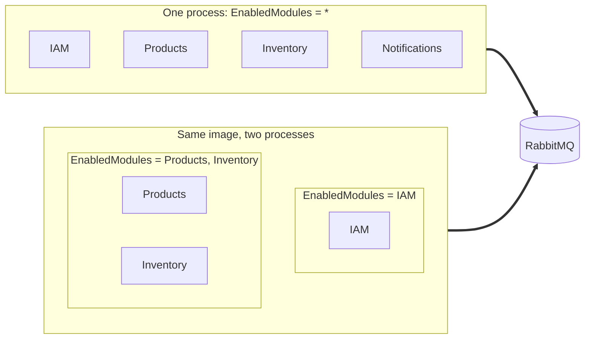
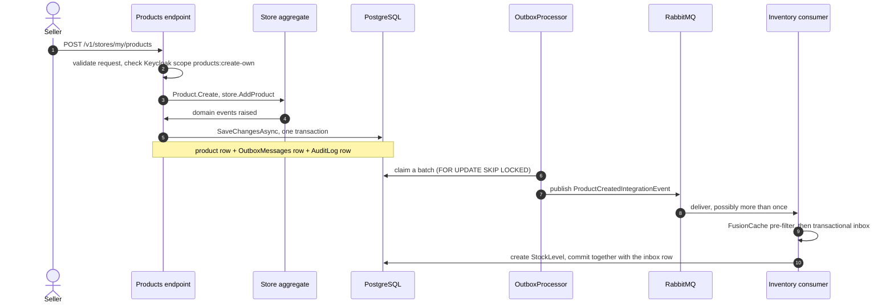

<div align="center">

# Modular Monolith · DDD · Vertical Slices

**Build it as a monolith. Ship it as microservices. Change one environment variable.**

[](https://github.com/baranacikgoz/modular-monolith-ddd-vsa-webapi/actions/workflows/ci_cd.yml)


[Quick start](#quick-start) · [One request, end to end](#follow-one-request) · [What is in the box](#what-is-in-the-box) · [Guardrails](#guardrails) · [Documentation](#documentation-map)

</div>

---

## The idea

The standard advice for a modular monolith is "extract services later". In practice, later is a multi-month project: new repositories, new pipelines, every in-process call rewritten as an HTTP client, retries and circuit breakers added at each call site, tracing wired from scratch.

This template deletes that project. Modules never reference each other. They talk through two contracts that already work across process boundaries (integration events and inter-module requests, both over RabbitMQ), so where a module runs is a deployment setting, not a code change.

```bash
# Everything in one process (the default in modules.json)
ModulesOptions__EnabledModules__0=*

# The same image, running only the catalogue module
ModulesOptions__EnabledModules__0=Products
```



The call site that works in-process works across processes without a single changed line, and the trace context travels with every message. A runnable two-process demo lives in [`docs/split-deployment-poc.md`](docs/split-deployment-poc.md).

This is deployment isolation on demand, not full microservices. [`docs/ARCHITECTURE.md`](docs/ARCHITECTURE.md) explains every decision, its trade-offs and where it stops.

## Follow one request

A seller adds a product to their store. Here is everything that happens, and everything you did not have to write:



1. The endpoint is a single method chained with `CombineAsync`, `TapAsync` and `MapAsync`. A failure anywhere short-circuits into a localized `ProblemDetails` response.
2. The aggregate enforces the invariants and records what happened as versioned, frozen domain events.
3. The state change, the outbox row and the audit row commit atomically. There is no dual write and nothing to forget.
4. The outbox processor publishes at least once. The consumer deduplicates with a cache pre-filter and a database inbox, so a redelivery has no second effect.
5. If Inventory runs in another process, nothing above changes.

The Keycloak scope check, the rate limiter, the structured logs, the OpenTelemetry spans and the audit trail come from the platform, not from the feature.

## Quick start

You need the .NET 10 SDK, Docker, GNU Make and the EF Core CLI (`dotnet tool install --global dotnet-ef`).

```bash
git clone https://github.com/baranacikgoz/modular-monolith-ddd-vsa-webapi.git
cd modular-monolith-ddd-vsa-webapi

# 1. One shared Docker network, created once (skip if it already exists)
docker network create local_shared_network

# 2. Backing services. Keycloak imports the realm from keycloak/realm-modular-monolith.json on first start.
docker compose up -d mm.postgres mm.rabbitmq mm.redis mm.keycloak mm.aspire-dashboard

# 3. Create the database and apply every module's migrations (local development only)
make ef-update-all

# 4. Build and start the API on http://localhost:5001
docker compose up --build host
```

The API refuses to boot while a module has pending migrations (see [Database changes](#database-changes)), which is why step 3 comes first.

| What | Where |
| :-- | :-- |
| Swagger UI (Development only) | http://localhost:5001/swagger |
| Health probes | `/health/live`, `/health/ready`, `/health/startup`, `/health/dependencies` |
| Hangfire dashboard (needs the `hangfire:manage` scope) | http://localhost:5001/hangfire |
| Aspire Dashboard (traces, metrics, structured logs) | http://localhost:18888 |
| Keycloak admin console (`admin` / `admin`) | http://localhost:8080 |
| RabbitMQ management (`guest` / `guest`) | http://localhost:15672 |

Sign in as the seeded system administrator. In development the SMS provider is `Dummy` and the one-time code is always `123456`:

```bash
curl -s -X POST http://localhost:5001/otp/login \
  -H 'Content-Type: application/json' \
  -d '{"phoneNumber":"901111111111"}'

curl -s -X POST http://localhost:5001/tokens \
  -H 'Content-Type: application/json' \
  -d '{"phoneNumber":"901111111111","otp":"123456","deviceId":"00000000-0000-4000-8000-000000000001","clientId":"mobile-app-1"}'
```

The second call returns `accessToken`, `refreshToken` and their expiry times. Paste the access token into Swagger's **Authorize** button, or send it as `Authorization: Bearer <token>`. More seeded users, the email and password login and the whole Keycloak model are in [`keycloak/README.md`](keycloak/README.md). A fuller walkthrough with an IDE, a split deployment and the load test is in [`docs/getting-started.md`](docs/getting-started.md).

## Modules

| Module | What it owns | Database |
| :-- | :-- | :-- |
| **IAM** | Login, registration, tokens, sessions and permissions, brokered through Keycloak. Phone + SMS OTP or email + password. | None. Keycloak is the identity store. |
| **Products** | Stores, product templates and products. The exemplar module: copy its shape. | Schema `Products` |
| **Inventory** | Stock levels and stock reservations (a saga-shaped aggregate), a warehouse gateway, an HMAC-signed webhook and an expiry sweep job. | Schema `Inventory` |
| **Notifications** | SMS, email, push (Firebase), SignalR hub, OTP issuing and verification, device registry. | Schema `Notifications` |
| **Outbox** | Transactional outbox processor, cleanup, lag metrics and the inbox cleanup job. Loads on every instance. | Schema `Outbox` |
| **BackgroundJobs** | Hangfire server, dashboard, job metrics and the no-overlap filter. Loads on every instance. | Schema `BackgroundJobs`, created by Hangfire itself |

Routes, scopes, events, requests, jobs and configuration for each module are in [`docs/modules.md`](docs/modules.md).

## What is in the box

### Architecture

| Capability | What you get |
| :-- | :-- |
| Configuration-driven modules | `modules.json` lists the enabled modules (`"*"` for all). Modules are found by assembly scan and start in an explicit priority order. Outbox and BackgroundJobs are core modules that always load. |
| Compiler-enforced boundaries | No module project references another. Architecture tests and a commit guard fail the build the moment one does. |
| DDD on writes, vertical slices on reads | Writes go endpoint, aggregate method, domain event, save. Reads project straight into DTOs with `AsNoTracking`. |
| REPR minimal APIs | One folder per feature: `Endpoint.cs`, `Request.cs` with its validator inline, `Response.cs`. URL-segment API versioning (`/v1/...`); IAM and Notifications routes are version neutral. |
| Railway-oriented code | A `Result<T>` monad with `BindAsync`, `TapAsync`, `MapAsync` and `CombineAsync`. Errors carry a key, a parameter, a value and an HTTP status, and become localized `ProblemDetails`. |
| Strongly typed ids | Ids are value types with EF converters, route binding and a Swagger schema filter. A test forbids reaching into `.Value` inside a query. |
| Versioned, frozen domain events | A shipped `V1` event never changes. New shapes ship as `V2`. A contract test enforces which payload types an event may carry. |
| Database per module | Each module owns a `DbContext` and a PostgreSQL schema. Point its connection string at another server to split the data. |

### Reliable messaging

| Capability | What you get |
| :-- | :-- |
| Transactional outbox | Events are written in the same transaction as the state change. The processor claims batches with `FOR UPDATE SKIP LOCKED`, publishes in parallel, retries with backoff, cleans up after itself and exports lag metrics. |
| Transactional inbox | Consumers inherit `IntegrationEventHandlerBase<T>`: a FusionCache pre-filter plus a `ProcessedMessages` row committed with the handler's own save. A scheduled job prunes old rows. |
| Event coalescing | Events implementing `ICoalescableIntegrationEvent` collapse into one outbox row per type and key per save, so a bulk change does not become a message storm. |
| Inter-module requests | `IInterModuleRequestClient<TRequest, TResponse>` runs over MassTransit request/response, with per-request timeouts and a dedicated receive endpoint per handler. A timeout reaches the HTTP client as `503` with `Retry-After`, a handler fault as `502`. |
| No ordering assumptions | Delivery order is never guaranteed. Ready-made projection building blocks (`ProjectionEntity`, `UpsertIfNewerAsync`) drop stale events, and a reconciliation job heals drift. |
| Trace context across hops | The trace context is stored with each outbox row and sent with the message, so a consumer in another process can continue the same trace. |

### Identity and access

| Capability | What you get |
| :-- | :-- |
| Keycloak, realm as code | Users, roles, clients, flows, authorization services and seed users live in `keycloak/realm-modular-monolith.json`. Compose, tests and production start import the same file. Clients only talk to this API. |
| Two login schemes | Phone + SMS OTP for end users, email + password with email verification for staff. `identityScheme.json` picks which self-service registration and login routes exist (`PhoneNumber` or `Email`). |
| Fine-grained permissions | Endpoints declare `.RequireScope(KeycloakScopes.X.Y)`. The API asks Keycloak for a `resource#scope` decision with the caller's token and caches it per token. A test keeps code and realm in sync. |
| Sessions and devices | Every login binds a device and client. Users can list their sessions, revoke one or revoke all. Access tokens live 5 minutes and refresh tokens rotate. |
| Token reuse defence | Replaying a rotated refresh token revokes the whole user session and sends the user a security alert push. |
| Machine callers | A client-credentials sample (`ci-integration`) shows service-to-service access through a service account policy. |
| Optional captcha | reCAPTCHA with a score threshold behind the `IAM.Captcha` feature flag. A `Dummy` provider passes everything in development. |

### Data and search

| Capability | What you get |
| :-- | :-- |
| EF Core 10 on PostgreSQL | One `DbContext` per module, queries tagged with `TagWith`, unique-violation mapping through `EntityFrameworkCore.Exceptions`. |
| Multilingual full-text search | Per-row authored language, generated `tsvector` columns with GIN indexes, accent folding, relevance ranking. See [`docs/full-text-search.md`](docs/full-text-search.md). |
| Trigram and pattern indexes | `HasTrigramIndex` and `HasPatternIndex` plus `LikePattern.Contains` and `LikePattern.StartsWith` for names, codes and barcodes a user types a fragment of. |
| Automatic audit trail | Every domain event an aggregate raises is stored in `AuditLog` (type, version, payload, actor) in the same transaction. A retention job prunes it (90 days by default, per-schema overrides) and history endpoints page it with a keyset cursor. |
| Offset and keyset pagination | `PageNumber`/`PageSize` or an opaque `After` cursor with a tiebreaker. `IncludeTotal=false` skips the `COUNT(*)`. |
| S3-compatible object storage | A public store for CDN-cached objects and a private store with presigned upload and download URLs. Circuit breaker, retries and multipart uploads are configurable. |
| Caching | FusionCache with a size-bounded in-memory L1. Switch on Redis for an L2 and a backplane, with fail-safe settings for slow or failing sources. |
| Seeding | Ordered `IDatabaseSeeder`s run after the host has fully started. |
| Job building blocks | `JobRow`, claim extensions and a housekeeping job for modules that accept work and process it later. |

### Resilience and protection

| Capability | What you get |
| :-- | :-- |
| Rate limiting | Named fixed-window policies (global, SMS, email, OTP verify, registration, registration check, token create and refresh, own-store creation). With Redis configured every replica shares one counter, without it an in-process limiter takes over. Each policy chooses to fail open or closed. |
| Keyed resilience pipelines | Outbound HTTP gets timeouts, retries and circuit breakers from `ResiliencyOptions`, with keyed overrides per dependency. |
| Webhook hardening | Constant-time HMAC-SHA256 verification (hex or base64, with or without `sha256=`) and a request body size limit. |
| Security headers | Configurable response headers from `securityHeaders.json`: `Content-Security-Policy`, `Strict-Transport-Security`, `X-Frame-Options`, `X-Content-Type-Options`, `Referrer-Policy` and `Permissions-Policy`. |
| Reverse proxy support | Forwarded headers honoured only from configured trusted networks. |
| Request and response logging | Size-capped body logging with per-path redaction for tokens, OTP codes and registrations, and path exclusions. |
| Feature management | `Microsoft.FeatureManagement` with targeting and variants, plus a `.RequireFeature(...)` endpoint filter. |
| Health checks | Separate live, ready, startup and dependency probes. PostgreSQL, RabbitMQ and Redis (when configured) gate readiness. Keycloak is reported on the dependency probe only, and only in a process that runs the IAM module, so an outage never takes the whole API out of rotation. |

### Notifications and background work

| Capability | What you get |
| :-- | :-- |
| SMS, email, push | NetGSM, Brevo and Firebase Cloud Messaging adapters. Each has a `Dummy` provider that logs instead of sending, which startup validation rejects in Production. |
| OTP with quotas | Configurable code length, expiry, resend interval and per-recipient and daily send caps. Templates are localized. |
| SignalR hub | `/hubs/notifications` for authenticated users, with an optional Redis backplane that production configuration requires by default. |
| Device registry | Device sessions per user, push token updates and a scheduled reconciliation job. |
| Hangfire jobs | PostgreSQL storage, a dashboard guarded by a Keycloak scope, recurring jobs that never overlap themselves, last-success gauges, and an `IsServer` switch to keep an instance out of job execution. |

### Observability

| Capability | What you get |
| :-- | :-- |
| OpenTelemetry | Traces and metrics over OTLP with ASP.NET Core, HTTP, EF Core, Npgsql, runtime and process instrumentation. Every module has its own `ActivitySource` and `Meter` named `ModularMonolith.{Module}`. |
| Serilog | Console, rolling compact-JSON files and an optional Seq, Elasticsearch or OTLP sink. Logs are enriched with the user, the trace and the span, and use source-generated `[LoggerMessage]` methods only. |
| Aspire Dashboard | Included in Docker Compose, so traces, metrics and logs work before you configure anything else. |

### Quality, tooling and delivery

| Capability | What you get |
| :-- | :-- |
| Real-infrastructure tests | xUnit v3 on Microsoft.Testing.Platform with Testcontainers (PostgreSQL, Keycloak), Respawn resets, Bogus data and NSubstitute for external APIs only. |
| CI matrix | Build, migration drift check, then one test job per module on separate runners. Release and hotfix branches, or a manual run with a tag, also build and push the Docker image. |
| Load testing | A k6 suite with buyer, seller, new seller and admin scenarios (50 virtual users at peak). `make perf` runs it with the Aspire Dashboard open. |
| Postman collection | `postman/ModularMonolith-API.postman_collection.json` covers the IAM, Products, Inventory and Notifications endpoints, including the HMAC-signed warehouse webhook. |
| Compose variants | Full stack, app only, performance run and the two-instance split deployment. |
| Localization | Turkish (default) and English through `Aigamo.ResXGenerator`, so every message is a strongly typed `IResxLocalizer` member. |
| Strict compiler | `TreatWarningsAsErrors`, `AnalysisMode all` and SonarAnalyzer on every project. |

## Guardrails

Conventions rot under deadline pressure. These do not, because the build checks them:

| Rule | Enforced by |
| :-- | :-- |
| A module never depends on another module | `ModuleBoundaryTests`, plus a hook that blocks `git commit` while a module `.csproj` references another |
| Integration events live only in `Common.IntegrationEvents` | `ModuleBoundaryTests` |
| Domain events carry only frozen payload types | `DomainEventContractTests` |
| Queries never compare a strongly typed id through `.Value` (EF cannot translate it) | `StronglyTypedIdQueryTests` |
| Aggregate methods take child entities, never child ids | `AggregateChildEntityParameterTests` |
| Every endpoint scope exists in the Keycloak realm, and every realm scope is used | `PermissionCoverageTests` |
| Handlers that bind request parts declare `[AsParameters]` | `EndpointParameterBindingTests` |
| Every model migration has a committed SQL script | `make check-migration-drift`, run in CI |
| The app never starts against an unmigrated database | `MigrationGuard` |
| Production never boots with a fake provider | Startup validation rejects the `Dummy` SMS, email, push, captcha and warehouse providers, a fixed OTP code, a cache without Redis (unless explicitly allowed) and SignalR without a Redis backplane |
| Zero warnings | `TreatWarningsAsErrors` with analyzers on |

## Database changes

Schema changes are reviewed, not applied by the application. The workflow:

```text
1. make ef-add-Products name=AddPriceColumn          create the migration
2. make ef-script-Products from=<previous> to=<new>   generate idempotent SQL into migrations/Products/
3. commit the .cs migration and the .sql script together
4. your DBA or deploy sidecar applies the .sql
5. deploy. The app checks for pending migrations and refuses to start if any remain.
```

In test runs pending migrations are applied automatically. For local development use `make ef-update-all`, which creates the database and applies every module's migrations in one command.

## Developer commands

Everything goes through the Makefile.

| Command | What it does |
| :-- | :-- |
| `make build` | Builds every project, excluding the Docker Compose project |
| `make test` | Runs all test projects one after another |
| `make test-{common,host,iam,products,inventory,outbox,notifications,backgroundjobs}` | Runs one test project |
| `make ef-add-{Notifications,Products,Inventory,Outbox} name=X` | Adds a migration to a module |
| `make ef-script-{Module} from=A to=B` | Generates an idempotent SQL script |
| `make ef-script-all from=A to=B` | Generates scripts for all modules |
| `make ef-update-all` | Creates the database and applies all migrations (local development only) |
| `make check-migration-drift` | Fails when a model migration has no committed SQL script |
| `make perf` / `make perf-smoke` / `make perf-down` | Full k6 load test, 30 second smoke test, tear down |
| `make perf-rider`, `perf-rider-smoke`, `perf-rider-down` | The same against infrastructure an IDE already runs |
| `make sonar` | SonarQube analysis (needs a `.env` with the SonarQube variables) |

## Tech stack

| Area | Choice |
| :-- | :-- |
| Runtime | .NET 10, ASP.NET Core Minimal APIs, C# preview language version |
| Data | EF Core 10, Npgsql, PostgreSQL |
| Messaging | MassTransit 8 over RabbitMQ 3.13 |
| Identity | Keycloak 26 with Authorization Services |
| Caching | FusionCache 2 with optional Redis L2 and backplane |
| Background jobs | Hangfire with PostgreSQL storage |
| Validation and API | FluentValidation, Asp.Versioning, Swashbuckle |
| Observability | OpenTelemetry, Serilog, Aspire Dashboard |
| Object storage | AWSSDK.S3 (any S3-compatible service) |
| Providers | NetGSM (SMS), Brevo (email), Firebase Admin (push), reCAPTCHA |
| Tests | xUnit v3, Testcontainers, Respawn, NetArchTest, Bogus, NSubstitute, k6 |

## Built for AI coding agents

This repository treats AI agents as first-class contributors, because strict architecture is exactly what makes them useful.

- [`CLAUDE.md`](CLAUDE.md) is the numbered rulebook an agent (or a new teammate) reads first: architecture, platform services, exemplar files to copy, persistence rules, testing rules and the options pattern.
- [`.claude/commands/`](.claude/commands) holds 15 slash commands that encode the workflow: `plan-feature`, `scaffold-feature`, `scaffold-module`, `scaffold-test`, `execute-feature`, `add-integration-event`, `add-inter-module-request`, `manage-feature-flag`, `manage-migration`, `fix-bug`, `plan-refactor`, `execute-refactor`, `audit-architecture`, `verify-feature` and `update-dependencies`.
- Two hooks in [`.claude/hooks/`](.claude/hooks) stop an agent from creating a cross-module project reference, after a project file edit and again before a commit.
- A generated knowledge graph in `graphify-out/` lets an agent answer "where does this live" without grepping the tree.

Details are in [`docs/ai-workflow.md`](docs/ai-workflow.md). None of it is required: the code is ordinary .NET and works with any editor.

## Documentation map

| Document | Read it to |
| :-- | :-- |
| [`docs/getting-started.md`](docs/getting-started.md) | Run the system, try the API, run the tests, split the deployment, run the load test |
| [`docs/ARCHITECTURE.md`](docs/ARCHITECTURE.md) | Understand why the architecture looks the way it does |
| [`docs/modules.md`](docs/modules.md) | See every module's routes, scopes, events, requests, jobs and settings |
| [`docs/platform.md`](docs/platform.md) | See how the shared building blocks work and when to use each |
| [`docs/full-text-search.md`](docs/full-text-search.md) | Add or tune multilingual search |
| [`docs/split-deployment-poc.md`](docs/split-deployment-poc.md) | Watch two processes cooperate with no HTTP between them |
| [`docs/ai-workflow.md`](docs/ai-workflow.md) | Use or adapt the agent workflow |
| [`keycloak/README.md`](keycloak/README.md) | Edit the realm, understand the permission model, rotate secrets |
| [`src/Host/Host/Configurations/README.md`](src/Host/Host/Configurations/README.md) | Configure an environment and deploy |

## Contributing

Issues and pull requests are welcome. [`CONTRIBUTING.md`](CONTRIBUTING.md) explains the workflow and the checks a change must pass. Report vulnerabilities privately as described in [`SECURITY.md`](SECURITY.md).

## License

Apache License 2.0. See [`LICENSE`](LICENSE).
