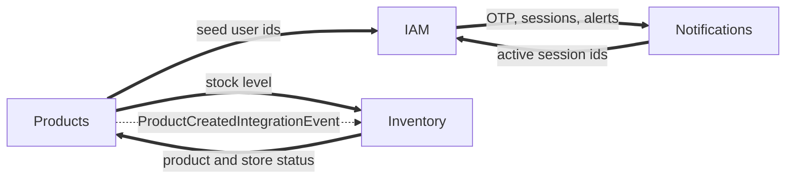

# Modules

This is the reference for what each module owns: routes and the permission each one needs, domain events, integration events, inter-module requests, scheduled jobs and settings. For the reasons behind the structure read [`ARCHITECTURE.md`](ARCHITECTURE.md). For the shared building blocks every module uses read [`platform.md`](platform.md).

## How modules fit together

| Module | Startup order | Kind | Test target |
| :-- | :-- | :-- | :-- |
| BackgroundJobs | 0 | Core, always loads | `make test-backgroundjobs` |
| Outbox | 1 | Core, always loads | `make test-outbox` |
| IAM | 2 | Optional | `make test-iam` |
| Notifications | 3 | Optional | `make test-notifications` |
| Products | 4 | Optional | `make test-products` |
| Inventory | 5 | Optional | `make test-inventory` |

Optional modules are enabled by `ModulesOptions.EnabledModules` in `src/Host/Host/Configurations/modules.json`. The value `"*"` enables all of them. Core modules load in every process because the transactional write path depends on them.

Every business module follows the same layout: `{M}.Domain` (aggregates, `DomainEvents/v1`, errors, ids), `{M}.Application` (`I{M}DbContext`, event handlers), `{M}.Endpoints` (feature folders and `{M}Module.cs`), `{M}.Infrastructure` (DbContext, EF configuration, inter-module request handlers, telemetry, migrations) and `{M}.Tests`.

Which module talks to which:

Solid arrows are synchronous inter-module requests, the dashed arrow is an integration event. Both travel over RabbitMQ.

---

## IAM

Identity and access, brokered through Keycloak. IAM has no database: Keycloak owns users, roles, sessions and permissions, and the API asks it for decisions. The self-service routes that exist depend on `IdentitySchemeOptions.Scheme` (`identityScheme.json`), a one-time choice per deployment.

| Method and path | Needs | Notes |
| :-- | :-- | :-- |
| `POST /otp/login` | anonymous | Sends a login code. PhoneNumber scheme only. Rate policy `Sms`. |
| `POST /otp/registration` | anonymous | Sends a registration code. PhoneNumber scheme only. Rate policy `Sms`. |
| `POST /otp/email` | anonymous | Sends an email code. Both schemes. Rate policy `Email`. |
| `POST /otp/email/verify` | anonymous | Verifies an email code and returns a verification token. Both schemes. Rate policy `OtpVerify`. |
| `POST /tokens` | anonymous | Phone number and code for tokens. PhoneNumber scheme only. Rate policy `TokenCreate`. |
| `POST /tokens/email` | anonymous | Email, password and verification token for tokens. Both schemes (staff sign in this way). Rate policy `TokenCreate`. |
| `POST /tokens/refresh` | anonymous | Rotates the refresh token. Rate policy `TokenRefresh`. |
| `POST /tokens/revoke` | `sessions:revoke-own` | Revokes the caller's current session. |
| `GET /tokens/sessions` | `sessions:view-own` | Lists the caller's sessions. |
| `DELETE /tokens/sessions/{id}` | `sessions:revoke-own` | Revokes one session. |
| `POST /tokens/sessions/revoke-all` | `sessions:revoke-own` | Signs out everywhere. |
| `POST /users/register/self` | anonymous | Phone self-registration. PhoneNumber scheme only. Rate policy `Register`. |
| `GET /users/check-registration` | anonymous | Tells whether a phone number is registered. PhoneNumber scheme only. |
| `POST /users/register/self/email` | anonymous | Email self-registration. Email scheme only. |
| `GET /users/me` | `users:view-own` | The caller's profile, roles and permissions. |
| `GET /users/{id}` | `users:view` | Any user. |
| `GET /users/search` | `users:search` | Searches users. |
| `GET /captcha/client-key` | anonymous | The public captcha key. Gated by the `IAM.Captcha` feature flag. |

**Serves** inter-module requests: `GetSeedUserIds`, `GetActiveSessionIds`, `GetUsersInRolePage` (a reconciliation pager).
**Calls** Notifications for OTP sending and verification, verification tokens, device session binding and security alerts.
**Settings**: `keycloak.json`, `identityScheme.json`, `captcha.json`, `devices.json`, and the `Register`, `Sms`, `Email`, `OtpVerify`, `TokenCreate`, `TokenRefresh` and `CheckRegistration` entries of `rateLimiting.json`.

How a login works. The backend verifies the one-time code itself (through Notifications), then calls Keycloak's `trusted-login` direct-grant flow, which has no credential step. That is why the `backend-trusted-login` client secret is as sensitive as every user's password. See [`keycloak/README.md`](../keycloak/README.md).

Things you will want to adapt in a fork: the default culture is Turkish (`localization.json`), and the email registration validators accept first and last names made of Turkish-alphabet letters and spaces only (`ContainsOnlyTurkishCharacters` in `SelfRegisterByEmail/Request.cs`).

## Products

A standard DDD module and the exemplar to copy when writing a new one: stores, product templates and products. Read endpoints project straight to DTOs. Write endpoints go through the aggregate.

Routes live under `/v1`. The "my" routes act on the caller's own store and need the `-own` scopes.

| Method and path | Needs |
| :-- | :-- |
| `POST /v1/stores` | `stores:create` |
| `GET /v1/stores/{id}` | `stores:view` |
| `PUT /v1/stores/{id}` | `stores:update` |
| `POST /v1/stores/{id}/deactivate` | `stores:update` |
| `GET /v1/stores/search` | `stores:search` |
| `GET /v1/stores/{id}/audit-log` | `stores:view` |
| `POST /v1/stores/{id}/products` | `products:create` |
| `DELETE /v1/stores/{id}/products/{productId}` | `products:delete` |
| `POST /v1/stores/my` | `stores:create-own` |
| `GET /v1/stores/my` | `stores:view-own` |
| `PUT /v1/stores/my` | `stores:update-own` |
| `GET /v1/stores/my/audit-log` | `stores:view-own` |
| `POST /v1/stores/my/products` | `products:create-own` |
| `DELETE /v1/stores/my/products/{id}` | `products:delete-own` |
| `GET /v1/products/{id}` | `products:view` |
| `PUT /v1/products/{id}` | `products:update` |
| `GET /v1/products/search` | `products:search` |
| `GET /v1/products/{id}/audit-log` | `products:view` |
| `GET /v1/products/my/{id}` | `products:view-own` |
| `PUT /v1/products/my/{id}` | `products:update-own` |
| `GET /v1/products/my/search` | `products:search-own` |
| `POST /v1/product-templates` | `product-templates:create` |
| `GET /v1/product-templates/{id}` | `product-templates:view` |
| `GET /v1/product-templates/search` | `product-templates:search` |
| `POST /v1/product-templates/{id}/activate` | `product-templates:update` |
| `POST /v1/product-templates/{id}/deactivate` | `product-templates:update` |
| `GET /v1/probe/cross-module` | anonymous |

`GET /v1/products/{id}` returns `availableQuantity`, filled by a synchronous request to Inventory. If Inventory is down or has not consumed the creation event yet, the field is `0` and the read still succeeds. `GET /v1/probe/cross-module?count=N` exists to prove a cross-process call (see [`split-deployment-poc.md`](split-deployment-poc.md)).

**Aggregates**: `Store` (with a status and a list of products), `Product`, `ProductTemplate`. Domain events are versioned and frozen (`V1ProductCreatedDomainEvent`, `V1ProductPriceIncreasedDomainEvent`, `V1StoreCreatedDomainEvent`, `V1StoreEmptiedDomainEvent`, `V1ProductAddedToStoreDomainEvent` and others in `Domain/*/DomainEvents/v1`).
**Publishes** integration events: `ProductCreatedIntegrationEvent`, `StoreCreatedIntegrationEvent`. Inventory consumes the first one.
**Serves** `GetProduct`. **Calls** `GetStockLevel` (Inventory) and `GetSeedUserIds` (IAM, for seeding and the probe).
**Seeding**: a seeder creates sample stores, product templates and products after startup.
**Settings**: the `CreateStore` rate limit policy in `rateLimiting.json` limits `POST /v1/stores/my` per user (one store creation per week by default). The admin route `POST /v1/stores` is not limited by it, because it creates stores on behalf of other owners. Full-text search settings are in `fullTextSearch.json`.

## Inventory

Stock levels and stock reservations. It is the advanced exemplar: a saga-shaped aggregate, an external gateway behind a provider switch, an HMAC-signed webhook, a sweep job and cross-module wiring in both directions.

| Method and path | Needs |
| :-- | :-- |
| `POST /v1/stock-reservations` | `stock-reservations:create` |
| `POST /v1/stock-reservations/series` | `stock-reservations:create` |
| `GET /v1/stock-reservations/{id}` | `stock-reservations:view` |
| `POST /v1/stock-reservations/{id}/commit` | `stock-reservations:update` |
| `POST /v1/stock-reservations/{id}/release` | `stock-reservations:update` |
| `POST /v1/stock-reservations/webhooks/warehouse` | anonymous, authenticated by the `X-Warehouse-Signature` HMAC-SHA256 header |

A `StockReservation` moves through `Active`, `Committed`, `Released`, `Expired` and `RequiresReconciliation`. The last state is reached when a commit arrives with a different provider reference than the one already recorded, which is never resolved automatically.

- **Reserve** creates an active reservation with a deadline.
- **Reserve series** creates one reservation per occurrence, spaced `IntervalDays` apart from `FirstDeadline`. Only the first occurrence carries the extra `SafetyBufferQuantity`. It asks Products over an inter-module request whether the product exists and its store is active. The per-warehouse allocation in the request is validated but not stored yet.
- **Release** persists an attempt marker, calls the warehouse gateway, then persists the outcome in a second save. The endpoint is deliberately imperative to keep that order crash-safe.
- **Expiry sweep** is a scheduled job that expires overdue reservations in batches.

**Aggregates**: `StockLevel`, `StockReservation`, with versioned events such as `V1StockReservationReservedDomainEvent`, `V1StockReservationCommittedDomainEvent`, `V1StockReservationExpiredDomainEvent`, `V1StockReservationCommitConflictDetectedDomainEvent` and `V1StockLevelCreatedDomainEvent`.
**Consumes** `ProductCreatedIntegrationEvent` (creates the stock level, with a domain-level duplicate check on top of the inbox, and logs the catalog change).
**Serves** `GetStockLevel`. **Calls** `GetProduct` (Products).
**Settings** (`inventory.json`, class `InventoryOptions`):

| Setting | Meaning |
| :-- | :-- |
| `WarehouseGatewayProvider` | `Dummy` (in-memory, always succeeds, rejected in Production) or `Http` |
| `WarehouseGatewayBaseUrl` | Base address of the warehouse system for the `Http` provider |
| `WebhookSharedSecret` | HMAC key for the warehouse webhook. Replace the committed development value |
| `WebhookMaxBodyBytes` | Request body limit for the webhook |
| `StockReservationExpirySweepCron`, `StockReservationExpirySweepBatchSize` | When the sweep runs and how many rows it handles per run |
| `MaxOccurrencesPerSeries`, `SafetyBufferQuantity` | Limits for series reservations |

## Notifications

Everything that reaches a person, plus the device registry. Each channel sits behind a provider switch with a `Dummy` provider for development.

| Capability | Provider | Settings |
| :-- | :-- | :-- |
| SMS | `Dummy` or NetGSM | `sms.json`: timeouts, retries, per-number and daily caps, localized templates |
| Email | `Dummy` or Brevo | `email.json`: sender, timeouts, retries, per-address and daily caps, localized templates |
| Push | `Dummy` or Firebase Cloud Messaging | `push.json`: service account, send timeout, localized templates (including the security alert) |
| One-time codes | the SMS and email channels | `otp.json`: code length, expiry, resend interval, per-recipient quotas, verification token lifetime, development `DummyCode` |
| Realtime | SignalR | `signalR.json`: optional Redis backplane, required in Production by default |

| Method and path | Needs |
| :-- | :-- |
| `PUT /notifications/devices/current/push-token` | `devices:update-own` |
| `/hubs/notifications` (SignalR) | any authenticated user |

**Serves** nine inter-module requests: `SendPhoneOtp`, `VerifyPhoneOtp`, `SendEmailOtp`, `VerifyEmailOtp`, `IssueVerificationToken`, `SendSecurityAlert`, `BindDeviceSession`, `DeactivateDeviceSessions` and `GetDeviceSessions`.
**Job**: a device registry reconciliation walks device sessions in batches and compares them with the active sessions IAM reports (`devices.json`: `ReconcileCron`, `ReconcileBatchSize`).
**Aggregate**: `DeviceRegistration`.

## Outbox

The platform side of reliable messaging. It runs on every instance because the write path of every other module depends on it. Details of the mechanism are in [`ARCHITECTURE.md`](ARCHITECTURE.md#5-transactional-outbox) and [`platform.md`](platform.md#transactional-outbox-and-inbox).

- `OutboxProcessor` claims batches with `FOR UPDATE SKIP LOCKED`, publishes up to `PublishConcurrency` at a time and retries with exponential backoff.
- `OutboxCleanupJob` deletes processed rows after a retention period. `OutboxMetricsJob` publishes lag and backlog metrics. `InboxCleanupJob` prunes the consumers' `ProcessedMessages` rows.
- Set `OutboxOptions.IsProcessor` to `false` on an instance that should write outbox rows but not publish them.

Settings are in `outbox.json` (`OutboxOptions`), `eventBus.json` (`RabbitMqOptions`) and `interModuleRequest.json`.

## BackgroundJobs

The Hangfire server and everything around it. It creates its own `BackgroundJobs` schema in PostgreSQL.

- `/hangfire` serves the dashboard. Access needs the `hangfire:manage` scope.
- `SkipOverlappingRecurringJobFilter` stops a recurring job from starting while its previous run is still going.
- `JobMetricsFilter` records job metrics, including a last-success timestamp gauge per job.
- Modules register recurring jobs through registrars (for example the stock reservation sweep and the device reconciliation).
- Set `BackgroundJobsOptions.IsServer` to `false` on an instance that must not execute jobs.

Settings are in `backgroundJobs.json`: polling frequency, dashboard path, worker count and the connection pool ceiling the worker count must stay under.

---

## Adding a module or a feature

The repository ships the workflow as commands in [`.claude/commands`](../.claude/commands) and as rules in [`CLAUDE.md`](../CLAUDE.md):

- A new module follows `scaffold-module`: four projects, DbContext, persistence setup, `IModule`, telemetry, tests and Makefile targets, mirroring Products file for file.
- A new feature follows `scaffold-feature`: `Endpoint.cs`, `Request.cs` with its inline validator, `Response.cs` and a registration line in `Setup.cs`.
- A cross-module fact follows `add-integration-event` (something happened) or `add-inter-module-request` (the caller cannot proceed without the answer).
- A schema change follows `manage-migration`.

Read [`ai-workflow.md`](ai-workflow.md) for how these fit together.
