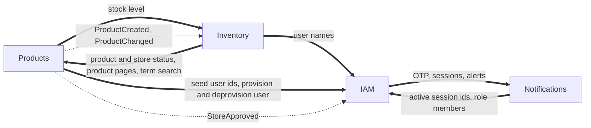

# Modules

This is the reference for what each module owns: routes and the permission each one needs, domain events, integration events, inter-module requests, scheduled jobs and settings. For the reasons behind the structure read [`ARCHITECTURE.md`](ARCHITECTURE.md). For the shared building blocks every module uses read [`platform.md`](platform.md).

## How modules fit together

| Module | Startup order | Kind | Test target |
| :-- | :-- | :-- | :-- |
| BackgroundJobs | 0 | Core, always loads | `make test-backgroundjobs` |
| Outbox | 1 | Core, always loads | `make test-outbox` |
| IAM | 2 | Optional | `make test-iam` |
| Notifications | 3 | Optional | `make test-notifications` |
| Products | 4 | Optional | `make test-products` |
| Inventory | 5 | Optional | `make test-inventory` |

Optional modules are enabled by `ModulesOptions.EnabledModules` in `src/Host/Host/Configurations/modules.json`. The value `"*"` enables all of them. Core modules load in every process because the transactional write path depends on them.

Every business module follows the same layout: `{M}.Domain` (aggregates, `DomainEvents/v1`, errors, ids), `{M}.Application` (`I{M}DbContext`, event handlers), `{M}.Endpoints` (feature folders and `{M}Module.cs`), `{M}.Infrastructure` (DbContext, EF configuration, inter-module request handlers, telemetry, migrations) and `{M}.Tests`.

Which module talks to which:

Solid arrows are synchronous inter-module requests, dashed arrows are integration events. Both travel over RabbitMQ.

---

## IAM

Identity and access, brokered through Keycloak. IAM has no database: Keycloak owns users, roles, sessions and permissions, and the API asks it for decisions. The self-service routes that exist depend on `IdentitySchemeOptions.Scheme` (`identityScheme.json`), a one-time choice per deployment.

| Method and path | Needs | Notes |
| :-- | :-- | :-- |
| `POST /otp/login` | anonymous | Sends a login code. PhoneNumber scheme only. Rate policy `Sms`. |
| `POST /otp/registration` | anonymous | Sends a registration code. PhoneNumber scheme only. Rate policy `Sms`. |
| `POST /otp/email` | anonymous | Sends an email code. Both schemes. Rate policy `Email`. |
| `POST /otp/email/verify` | anonymous | Verifies an email code and returns a verification token. Both schemes. Rate policy `OtpVerify`. |
| `POST /tokens` | anonymous | Phone number and code for tokens. PhoneNumber scheme only. Rate policy `TokenCreate`. |
| `POST /tokens/email` | anonymous | Email, password and verification token for tokens. Both schemes (staff sign in this way). Rate policy `TokenCreate`. |
| `POST /tokens/refresh` | anonymous | Rotates the refresh token. Rate policy `TokenRefresh`. |
| `POST /tokens/revoke` | `sessions:revoke-own` | Revokes the caller's current session. |
| `GET /tokens/sessions` | `sessions:view-own` | Lists the caller's sessions. |
| `DELETE /tokens/sessions/{id}` | `sessions:revoke-own` | Revokes one session. |
| `POST /tokens/sessions/revoke-all` | `sessions:revoke-own` | Signs out everywhere. |
| `POST /users/register/self` | anonymous | Phone self-registration. PhoneNumber scheme only. Rate policy `Register`. |
| `GET /users/check-registration` | anonymous | Tells whether a phone number is registered. PhoneNumber scheme only. |
| `POST /users/register/self/email` | anonymous | Email self-registration. Email scheme only. |
| `GET /users/me` | `users:view-own` | The caller's profile, roles and permissions. |
| `GET /users/{id}` | `users:view` | Any user. |
| `GET /users/search` | `users:search` | Searches users. |
| `GET /captcha/client-key` | anonymous | The public captcha key. Gated by the `IAM.Captcha` feature flag. |

**Serves** inter-module requests: `GetSeedUserIds`, `GetActiveSessionIds`, `GetUsersInRolePage` (a reconciliation pager over the members of a realm role), `GetUsers` (display data for a list of user ids, one request per page, cached per user), `ProvisionUser` (creates an identity-provider account with the baseline `basic` role and no business role) and `DeprovisionUser` (the compensation for a registration whose local write failed; a user that is already gone is not an error).
**Consumes** `StoreApprovedIntegrationEvent` and grants the `store-owner` realm role to the store's owner. IAM has no database, so the consumer uses `StatelessInboxStore` and relies on Keycloak's role mapping being idempotent. An owner Keycloak no longer knows is logged and skipped. If the role is missing from the realm the consumer throws and the bus retries, so a realm imported before the role existed needs it created by hand (see [`keycloak/README.md`](../keycloak/README.md)).
**Calls** Notifications for OTP sending and verification, verification tokens, device session binding and security alerts.
**Settings**: `keycloak.json`, `identityScheme.json`, `captcha.json`, `devices.json`, and the `Register`, `Sms`, `Email`, `OtpVerify`, `TokenCreate`, `TokenRefresh` and `CheckRegistration` entries of `rateLimiting.json`. The user lookup is tuned by four fields of `KeycloakOptions`:

| Setting | Meaning |
| :-- | :-- |
| `UserLookupConcurrency` | Most Keycloak `GET /users/{id}` calls one `GetUsers` request has in flight for its cache misses |
| `UserDisplayCacheDurationSeconds` | In-process lifetime of one user's cached display data |
| `UserDisplayCacheDistributedDurationSeconds` | Redis lifetime of the same entry. Long on purpose, a name changes only from the Keycloak console. Must be at least the in-process lifetime |
| `UserDisplayNegativeCacheDurationSeconds` | Lifetime of the entry cached for an id Keycloak does not know, so repeated lists do not ask again |

How a login works. The backend verifies the one-time code itself (through Notifications), then calls Keycloak's `trusted-login` direct-grant flow, which has no credential step. That is why the `backend-trusted-login` client secret is as sensitive as every user's password. See [`keycloak/README.md`](../keycloak/README.md).

Things you will want to adapt in a fork: the default culture is Turkish (`localization.json`), and the email registration validators accept first and last names made of Turkish-alphabet letters and spaces only (`ContainsOnlyTurkishCharacters` in `SelfRegisterByEmail/Request.cs`).

## Products

A standard DDD module and the exemplar to copy when writing a new one: stores, product templates and products. Read endpoints project straight to DTOs. Write endpoints go through the aggregate. It also carries the accept-queue-poll job family (product import and export), product images, and the store application and approval lifecycle.

Routes live under `/v1`. The "my" routes act on the caller's own store and need the `-own` scopes.

| Method and path | Needs |
| :-- | :-- |
| `POST /v1/stores` | `stores:create` |
| `GET /v1/stores/{id}` | `stores:view` |
| `PUT /v1/stores/{id}` | `stores:update` |
| `POST /v1/stores/{id}/deactivate` | `stores:update` |
| `GET /v1/stores/search` | `stores:search` |
| `GET /v1/stores/{id}/audit-log` | `stores:view` |
| `POST /v1/stores/{id}/products` | `products:create` |
| `DELETE /v1/stores/{id}/products/{productId}` | `products:delete` |
| `POST /v1/stores/applications` | anonymous. Rate policy `StoreApplication` |
| `GET /v1/stores/applications` | `stores:approve` |
| `POST /v1/stores/{id}/approve` | `stores:approve` |
| `POST /v1/stores/{id}/suspend` | `stores:suspend` |
| `POST /v1/stores/{id}/reinstate` | `stores:reinstate` |
| `POST /v1/stores/my` | `stores:create-own`. Rate policy `CreateStore` |
| `GET /v1/stores/my` | `stores:view-own` |
| `PUT /v1/stores/my` | `stores:update-own` |
| `GET /v1/stores/my/audit-log` | `stores:view-own` |
| `POST /v1/stores/my/products` | `products:create-own` |
| `DELETE /v1/stores/my/products/{id}` | `products:delete-own` |
| `GET /v1/products/{id}` | `products:view` |
| `PUT /v1/products/{id}` | `products:update` |
| `GET /v1/products/search` | `products:search` |
| `GET /v1/products/{id}/audit-log` | `products:view` |
| `GET /v1/products/my/{id}` | `products:view-own` |
| `PUT /v1/products/my/{id}` | `products:update-own` |
| `PUT /v1/products/my/{id}/attributes` | `products:update-own` |
| `PUT /v1/products/my/{id}/package-dimensions` | `products:update-own` |
| `GET /v1/products/my/search` | `products:search-own` |
| `POST /v1/products/{id}/images` | `products:update-own`. Multipart upload of one JPEG, PNG or WebP |
| `DELETE /v1/products/{id}/images/{imageId}` | `products:update-own` |
| `POST /v1/products/imports` | `products:import-own`. Multipart upload of a spreadsheet, answers 202 |
| `GET /v1/products/imports` | `products:import-own`. The caller's jobs, newest first |
| `GET /v1/products/imports/{id}` | `products:import-own` |
| `POST /v1/products/exports` | `products:export`. Answers 202 |
| `GET /v1/products/exports/{id}` | `products:export` |
| `GET /v1/products/exports/{id}/download` | `products:export`. The finished CSV file |
| `POST /v1/product-templates` | `product-templates:create` |
| `GET /v1/product-templates/{id}` | `product-templates:view` |
| `GET /v1/product-templates/search` | `product-templates:search` |
| `POST /v1/product-templates/{id}/activate` | `product-templates:update` |
| `POST /v1/product-templates/{id}/deactivate` | `product-templates:update` |
| `GET /v1/probe/cross-module` | anonymous |

`GET /v1/products/{id}` returns `availableQuantity`, filled by a synchronous request to Inventory. If Inventory is down or has not consumed the creation event yet, the field is `0` and the read still succeeds. `GET /v1/probe/cross-module?count=N` exists to prove a cross-process call (see [`split-deployment-poc.md`](split-deployment-poc.md)).

**Store application and approval.** `Store.Create` opens an `Active` store (the admin and "my" create routes). `POST /v1/stores/applications` is the anonymous path: it creates the owner's identity-provider account through `ProvisionUser`, then saves a store in `PendingApproval`, and returns neither a role nor a token. If the save fails after the account exists, the endpoint sends `DeprovisionUser` so a retry does not collide with a half-created account (the compensation exception named in `CLAUDE.md` section 3). `approve` moves `PendingApproval` to `Active` and raises `StoreApprovedIntegrationEvent`, from which IAM grants the `store-owner` role. `suspend` moves an `Active` store to `Suspended`, `reinstate` moves a `Suspended` one back, and `deactivate` is final (on a `PendingApproval` store it rejects the application). Each transition is idempotent when the store is already in the target state. The anonymous route is limited per client IP by the `StoreApplication` policy (5 per hour by default) and its body is redacted from request logs (`requestLogging.json`).

**Products**: a product may carry a `Sku` (the store's own code, unique within the store, set at creation and never changed; a duplicate answers `SkuAlreadyExists`), a list of name and value attributes (replaced whole through `PUT .../attributes`, at most `MaxAttributesPerProduct`, names unique without regard to case, stored as one jsonb column) and package dimensions (`PUT .../package-dimensions`: length, width and height in cm and weight in kg, each above zero and at most 1000, held by an owned value object in the product's row).

**Images**: `POST /v1/products/{id}/images` takes one multipart file of at most `ImageMaxFileBytes`. The type (JPEG, PNG or WebP) is read from the file's first bytes, never from its name. The object goes to the public store under a content-hash key, the row is saved afterwards, and the answer carries the image id and its public URL. A product holds at most `MaxImagesPerProduct` images.

**Import** (`POST /v1/products/imports`, form fields `File`, `ClientRequestId`, `ProductTemplateId`). The endpoint checks only the size and the extension (`.xlsx` or `.xls`), stores the workbook in the private object store, writes a `ProductImportJob` row and one `ProductImportRequestedIntegrationEvent` in the same transaction and answers 202 with the job. The queue consumer upserts the products of the caller's own store by name from the first worksheet (row 1 is the header; columns: A name, B description, optional, C quantity, D price, E SKU, optional), in batches of `BulkImportOptions.SaveChunkSize` rows, at most `ImportBatchesPerMessage` batches per message; a larger file continues in a message the job queues for itself. A repeated `ClientRequestId`, or an import already active for the caller, returns the existing job. A job is `Queued`, `Running`, `Succeeded` or `Failed`. `Failed` carries a `FailureKey` (`TooManyRows`, `FileUnreadable`, `NotFound`, `JobStale`, `UnexpectedError`). A `Succeeded` job lists the rows it rejected, up to `ImportMaxStoredRowErrors`, each as a row number and a reason key (`MissingName`, `NameTooLong`, `DescriptionTooLong`, `InvalidQuantity`, `InvalidPrice`, `SkuTooLong`, `SkuDiffers`, `SkuAlreadyExists`, `ConcurrentUpdate`); the other rows are imported. The uploaded workbook is deleted when the job finishes.

**Export** (`POST /v1/products/exports`, optional `StoreId` query). The same shape: a `ProductExportJob` row, one `ProductExportRequestedIntegrationEvent`, 202 with the job. The consumer reads the products created up to the moment of the request in keyset pages of `ExportPageSize`, writes a CSV (UTF-8 with a byte order mark; columns Id, StoreId, Name, Description, Quantity, Price, CreatedOn; a cell that starts like a formula is prefixed with an apostrophe) and stores it in the private store. More than `ExportMaxRows` products fails the job with `RowLimitExceeded`. `GET .../exports/{id}/download` answers the file once the job is `Succeeded` and 409 `NotReady` before that; another user's job is a 404. One import and one export can each be active per user at a time.

Finished job rows and their files are removed after `JobHousekeepingOptions.RetentionHours`, and a `Running` row nobody finished is failed with `JobStale` after `StaleAfterMinutes` (`ProductJobsHousekeeping`, cron `ProductsOptions.JobHousekeepingCron`).

**Aggregates**: `Store` (with a status and a list of products), `Product`, `ProductTemplate`. Domain events are versioned and frozen (`V1ProductCreatedDomainEvent`, `V1ProductPriceIncreasedDomainEvent`, `V1StoreCreatedDomainEvent`, `V1StoreEmptiedDomainEvent`, `V1ProductAddedToStoreDomainEvent` and others in `Domain/*/DomainEvents/v1`, plus the application lifecycle events `V1StoreApplicationSubmittedDomainEvent`, `V1StoreApprovedDomainEvent`, `V1StoreSuspendedDomainEvent` and `V1StoreReinstatedDomainEvent`). `V2StoreAddressUpdatedDomainEvent` in `Domain/Stores/DomainEvents/v2` replaces the V1 address event for new changes and adds the previous address; the V1 record stays so old audit rows still read.
**Publishes** integration events: `ProductCreatedIntegrationEvent`, `StoreCreatedIntegrationEvent`, `ProductChangedIntegrationEvent` (on creation and on a name change; it carries the product's `Version` so a consumer drops a stale event), `StoreApprovedIntegrationEvent`, and the two queue messages above, which only Products consumes. Inventory consumes the first and the third, IAM the fourth.
**Serves** `GetProduct`, `GetProductsPage` (one keyset page of every product, newest first, capped at `ProductsPageMaxSize`; the source of Inventory's nightly reconciliation, never a request path) and `SearchProductsByTerm` (free-text match on a product name or description, at most `FullTextSearchOptions.MaxMatchResults` ids, with an `IsTruncated` flag, cached for `SearchCacheSeconds`). **Calls** `GetStockLevel` (Inventory), `GetSeedUserIds` (IAM, for seeding and the probe) and `ProvisionUser` and `DeprovisionUser` (IAM, for store applications).
**Seeding**: a seeder creates sample stores, product templates and products after startup.
**Settings**: the `CreateStore` rate limit policy in `rateLimiting.json` limits `POST /v1/stores/my` per user (one store creation per week by default). The admin route `POST /v1/stores` is not limited by it, because it creates stores on behalf of other owners. Full-text search settings are in `fullTextSearch.json`. The job and image settings are in `products.json` (`ProductsOptions`) and `bulkImport.json` (`BulkImportOptions`, shared with the Inventory bulk adjustment):

| Setting | Meaning |
| :-- | :-- |
| `ProductsOptions.ImportJobConcurrentMessageLimit` | Import messages one process works on at once. Also the consumer's prefetch count |
| `ProductsOptions.ImportBatchesPerMessage` | Batches one import message saves before the job queues a continuation for itself |
| `ProductsOptions.ImportMaxStoredRowErrors` | Rejected rows kept on a job. The rest are only counted |
| `ProductsOptions.ExportJobConcurrentMessageLimit` | Export messages one process works on at once. Also the prefetch count |
| `ProductsOptions.ExportPageSize` | Products read per keyset page while an export is built |
| `ProductsOptions.ExportMaxRows` | An export of more products fails, the file is built in memory |
| `ProductsOptions.JobHousekeepingCron` | When the housekeeping of both job tables runs |
| `ProductsOptions.ImageMaxFileBytes`, `MaxImagesPerProduct` | Image upload limits |
| `ProductsOptions.MaxAttributesPerProduct` | Most attributes one product may carry |
| `ProductsOptions.ProductsPageMaxSize` | Largest page `GetProductsPage` returns, whatever the caller asks for |
| `ProductsOptions.SearchCacheSeconds` | How long a `SearchProductsByTerm` answer is cached. 0 turns the cache off |
| `BulkImportOptions.MaxFileBytes`, `MaxRows`, `SaveChunkSize` | Upload size ceiling, data rows allowed in one workbook, rows saved per batch |
| `FullTextSearchOptions.MaxMatchResults` | Cap on ids a cross-module term search returns |
| `JobHousekeepingOptions` (`jobHousekeeping.json`) | `StaleAfterMinutes`, `RetentionHours`, `PageSize` for every job table |
| `CustomRateLimitingOptions.StoreApplication` | Fixed window of the anonymous store application, per client IP |

## Inventory

Stock levels, stock reservations and warehouse connections. It is the advanced exemplar: a saga-shaped aggregate, an immutable stock ledger with low stock thresholds, per-store warehouse connections with encrypted credentials behind a per-provider gateway with its own resilience, an HMAC-signed webhook that applies each delivery once, a dirty-set stock push, a queued bulk adjustment, a local product projection, sweep jobs and cross-module wiring in both directions.

| Method and path | Needs |
| :-- | :-- |
| `GET /v1/stock-levels` | `stock-levels:view` |
| `GET /v1/stock-levels/{id}/movements` | `stock-levels:view` |
| `POST /v1/stock-levels/{id}/receive` | `stock-levels:update` |
| `POST /v1/stock-levels/{id}/adjust` | `stock-levels:update` |
| `PUT /v1/stock-levels/{id}/low-stock-threshold` | `stock-levels:update` |
| `POST /v1/stock-levels/bulk-adjustments` | `stock-levels:update`. Multipart upload of a spreadsheet, answers 202 |
| `GET /v1/stock-levels/bulk-adjustments` | `stock-levels:update`. The caller's jobs, newest first |
| `GET /v1/stock-levels/bulk-adjustments/{id}` | `stock-levels:update` |
| `POST /v1/warehouse-connections` | `warehouse-connections:create` |
| `GET /v1/warehouse-connections` | `warehouse-connections:view` |
| `GET /v1/warehouse-connections/{id}` | `warehouse-connections:view` |
| `PUT /v1/warehouse-connections/{id}/credentials` | `warehouse-connections:update` |
| `POST /v1/warehouse-connections/{id}/rotate-webhook-secret` | `warehouse-connections:update` |
| `POST /v1/warehouse-connections/{id}/deactivate` | `warehouse-connections:update` |
| `POST /v1/stock-reservations` | `stock-reservations:create` |
| `POST /v1/stock-reservations/series` | `stock-reservations:create` |
| `GET /v1/stock-reservations/{id}` | `stock-reservations:view` |
| `POST /v1/stock-reservations/{id}/commit` | `stock-reservations:update` |
| `POST /v1/stock-reservations/{id}/release` | `stock-reservations:update` |
| `POST /v1/stock-reservations/webhooks/warehouse/{connectionId}` | anonymous, authenticated by the `X-Warehouse-Signature` HMAC-SHA256 header made with that connection's webhook secret. Rate policy `WarehouseWebhook` |

A `StockReservation` moves through `Active`, `Committed`, `Released`, `Expired` and `RequiresReconciliation`. The last state is reached when a commit arrives with a different provider reference than the one already recorded, which is never resolved automatically.

- **Reserve** creates an active reservation with a deadline.
- **Reserve series** creates one reservation per occurrence, spaced `IntervalDays` apart from `FirstDeadline`. Only the first occurrence carries the extra `SafetyBufferQuantity`. It asks Products over an inter-module request whether the product exists and its store is active. The per-warehouse allocation in the request is validated but not stored yet.
- **Release** resolves the gateway of the product's store from its active warehouse connection, persists an attempt marker, calls the warehouse, then persists the outcome in a second save. A store without an active connection leaves no marker behind. The endpoint is deliberately imperative to keep that order crash-safe.
- **Expiry sweep** is a scheduled job that expires overdue reservations in batches.

**Stock levels and the ledger.** A `StockLevel` is created when `ProductCreatedIntegrationEvent` arrives. Its quantity changes only through three commands, and each appends one immutable `StockMovement` row (type, signed quantity, quantity after, reason, and the reservation id for a deduction): `receive` (positive quantity), `adjust` (signed, never zero, a reason is mandatory) and the deduction for a committed reservation. A change that would take the quantity below zero is refused with `InsufficientStock`. A row is never edited or deleted; a mistake is corrected by a new `Adjusted` row, and `StockMovementWriteGuardTests` keeps the `StockLevel` aggregate the only writer. `GET .../{id}/movements` pages the ledger newest first with the `After` cursor and names the acting users with one IAM `GetUsers` request per page (a movement made by a consumer has no actor).

**Low stock threshold.** `PUT .../{id}/low-stock-threshold` sets it (0 means no alert). A movement that takes the quantity from at or above the threshold to below it raises `V1StockLowThresholdCrossedDomainEvent` once, not once per movement below it; going back to at or above raises `V1StockLowThresholdRecoveredDomainEvent`. Changing the threshold across the current quantity counts as a crossing too. The handlers publish `StockLowThresholdCrossedIntegrationEvent` and `StockLowThresholdRecoveredIntegrationEvent`; no module consumes them in this repository.

**Stock list and the product projection.** `GET /v1/stock-levels` lists stock levels, least stock first, with each product's name from `ProductSummary`, Inventory's local copy of the product facts it needs (store id and name). The join is a native `LEFT JOIN`, so a level whose product is not projected yet is listed with a null name. `ProductName` narrows the list to the ids Products matches through `SearchProductsByTerm`; `IsTruncated` in the answer says that match list was cut at `MaxMatchResults`. Paging is by offset only. `ProductSummary` is fed by `ProductChangedIntegrationEvent` through `UpsertIfNewerAsync` and healed by `ProductSummariesReconciliationJob`, which pages Products' `GetProductsPage`. The copy is also what links a product to its store, so a movement or a release finds the store's warehouse connection through it.

**Committed reservations.** A commit, from the endpoint or from the webhook, raises `V1StockReservationCommittedDomainEvent`, which publishes `StockReservationCommittedIntegrationEvent`. Two consumers inside Inventory react. `DeductStockOnReservationCommittedHandler` loads the product's stock level under `SELECT ... FOR UPDATE` in an explicit transaction and deducts; it is idempotent three ways (the inbox row, a ledger check under the lock, and a unique index on the ledger's reservation id), and a reservation that cannot be deducted is logged and acknowledged. `CountCommittedStockOnReservationCommittedHandler` adds the reservation to the store's `StoreDailyStockTotals` row for the business day with one atomic `INSERT ... ON CONFLICT DO UPDATE` (`InventoryOptions.BusinessTimeZoneId` decides where a day starts). No endpoint reads the daily totals.

**Warehouse connections.** A connection says how one store reaches its warehouse system: a `Provider` (`JsonApi`: JSON bodies and a bearer token; `FormApi`: form-encoded bodies and an `X-Api-Key` header), an absolute https `BaseUrl` and the credentials of both directions. A store has at most one active connection (unique index), and `Deactivated` is final. `POST` generates the webhook secret and returns it exactly once, with the `WebhookPath` to give the warehouse system; the API credential and the webhook secret are stored encrypted by `SecretProtector` (key in `secretProtection.json`) and no endpoint returns either again. `credentials` replaces the API credential, `rotate-webhook-secret` issues a new secret (shown once, the old one stops verifying at once), and a deactivated connection takes no part in traffic. The gateway is built per call from the connection by `WarehouseGatewayFactory`, and every call goes through the connection's own Polly pipeline (rate limiter, circuit breaker, attempt timeout, no retry) built from the profile `Warehouse{Provider}` under `ResiliencyOptions.Keyed`, so one store's burst or outage cannot spend another store's quota or open its circuit. The pipeline has no retry on purpose: a release changes state at the warehouse, so a timeout surfaces as an unknown outcome (504 `WarehouseGatewayOutcomeUnknown`) and the attempt marker stays until it is reconciled. Our own quota or an open circuit stops a call before it is sent (429 `WarehouseGatewayThrottled`, 503 `WarehouseGatewayCircuitOpen`).

The wire shapes the gateway speaks, which a stand-in for a warehouse system has to answer:

| Call | `JsonApi` | `FormApi` |
| :-- | :-- | :-- |
| Authentication | `Authorization: Bearer {credential}` | `X-Api-Key: {credential}` |
| Release | `POST releases` with JSON `productReference`, `quantity`. Answers `{ "confirmationReference": "..." }` | `POST v2/holds/release` form `sku`, `units`. Answers `{ "result": { "reference": "..." } }` |
| Reconcile | `GET releases/{reference}/status`. Same answer | `GET v2/holds/release?sku={reference}`. Same answer |
| Push stock | `POST stock/levels` with JSON `items` of `productReference`, `quantity`. Same answer | `POST v2/stock/sync` form `sku[i]`, `units[i]`. Same answer |

Paths are resolved under the connection's `BaseUrl`. The product reference is the Products product id. An answer without a reference is `WarehouseGatewayMalformedResponse` (502); any other non-success status is `WarehouseGatewayCallFailed` (502); a 404 is `NotFound` and a 429 is `WarehouseGatewayThrottled`.

**Local development.** There is no `Dummy` warehouse provider and no global webhook secret, and the repository has no warehouse stand-in that answers on its own. To exercise release, push or the webhook locally, point a connection at any HTTPS server that answers the table above (the integration tests use `FakeWarehouseHandler` in `Inventory.Tests/Support` as the gateway client's primary handler, and `WarehouseConnectionTestData.SeedAsync` to create the connection). The steps against a running API:

1. Create a store and a product in it, so a stock level and a `ProductSummary` exist (Products publishes both events).
2. As a user with `warehouse-connections:create` (the system administrator), `POST /v1/warehouse-connections` with `{ "storeId": "<store id>", "provider": "JsonApi", "baseUrl": "https://<stand-in host>/", "apiCredential": "<any value>" }`. Keep the returned `webhookSecret` and `webhookPath`.
3. Release a reservation of a product of that store, or change its stock, and the stand-in receives the call. For the webhook, sign the raw body with the returned secret (HMAC-SHA256, header `X-Warehouse-Signature`) and `POST` it to `webhookPath` with `{ "deliveryId": "...", "reservationId": "<reservation id>", "providerReference": "..." }`.

**Webhook.** `POST /v1/stock-reservations/webhooks/warehouse/{connectionId}` is anonymous and rate limited per connection (the route value is the partition key, so one store's burst does not throttle the others behind the same provider address). The handler reads the raw bytes, finds the connection, verifies `X-Warehouse-Signature` in constant time against that connection's decrypted secret (401 `MissingWebhookSignature` or `InvalidWebhookSignature`; an unknown connection is 404), and only then parses the body (400 `MalformedWebhookBody`). A deactivated connection's authenticated delivery is acknowledged and ignored. A delivery is applied once per (connection, `deliveryId`): a quick lookup answers the usual repeat, and the unique index on the `WebhookDeliveries` row, saved in the same transaction as the reservation's commit, decides two identical deliveries that arrive together. A recorded delivery is acknowledged (204) whatever state the reservation has moved on to. A reservation of another store is a 404 for this connection. Recorded deliveries are deleted after `WebhookDeliveryRetentionDays` by a recurring job.

**Stock push.** Every quantity change marks the stock level dirty in the same transaction (`StockPushDirtyItems`, one row per stock level with an ever larger mark version drawn from a sequence) and collects a `StockPushDueIntegrationEvent` for the store's active connection; the events of one save coalesce into one message per connection, and a store without an active connection is not marked. The consumer takes a Postgres advisory-lock lease for the connection (a run that finds it held does nothing, the holder covers the marks), sends the current quantities in batches of `StockPushBatchSize` through the gateway and clears each batch by the version it read, so a change made during the push survives for the next one. A message makes at most `StockPushBatchesPerMessage` calls and then queues a continuation for itself. A refusal, a throttle or an unknown outcome stops the run with the marks in place, because every call carries absolute quantities that are simply sent again. A recurring sweep (`StockPushDirtySweepCron`) publishes the event again for connections with a mark older than `StockPushDirtyMinAgeSeconds`; it never calls the warehouse.

**Bulk adjustment** (`POST /v1/stock-levels/bulk-adjustments`, form fields `File`, `ClientRequestId`, `Reason`). The accept-queue-poll shape of `CLAUDE.md` section 12: the workbook goes to the private store, a `StockBulkAdjustJob` row and one `StockBulkAdjustRequestedIntegrationEvent` are written in one transaction, the answer is 202 with the job. The consumer reads the first worksheet (row 1 header; columns A product id, B signed quantity, never zero) and applies each row as an `Adjusted` movement with the request's one reason, in batches of `BulkImportOptions.SaveChunkSize`, at most `BulkAdjustBatchesPerMessage` batches per message. A bad row is rejected with a reason key and the file goes on; the first `BulkAdjustMaxStoredRowErrors` rejections are kept on the job. A repeated `ClientRequestId`, or an adjustment already active for the caller, returns the existing job. A consumer that died leaves the job `Running`: the recurring `StockJobRequeueService` (`StockJobRequeueCron`) hands a job `Running` for longer than `StockJobRunningLeaseMinutes` back to the queue, at most `StockJobMaxRequeues` times without progress, then fails it with `JobAbandoned`; housekeeping (`StockJobHousekeepingCron`) fails stale rows and deletes finished ones with their uploads.

**Aggregates**: `StockLevel`, `StockReservation`, `WarehouseConnection`, with versioned events such as `V1StockReservationReservedDomainEvent`, `V1StockReservationCommittedDomainEvent`, `V1StockReservationExpiredDomainEvent`, `V1StockReservationCommitConflictDetectedDomainEvent`, `V1StockLevelCreatedDomainEvent`, `V1StockQuantityChangedDomainEvent` and the four `V1WarehouseConnection...DomainEvent` records. `StockMovement`, `StoreDailyStockTotal`, `StockPushDirtyItem`, `WebhookDelivery`, `ProductSummary` and the job row are entities, not aggregates.
**Consumes** `ProductCreatedIntegrationEvent` (creates the stock level, with a domain-level duplicate check on top of the inbox, and logs the catalog change), `ProductChangedIntegrationEvent` (updates `ProductSummary`), and its own `StockReservationCommittedIntegrationEvent`, `StockPushDueIntegrationEvent` and `StockBulkAdjustRequestedIntegrationEvent`.
**Serves** `GetStockLevel`. **Calls** `GetProduct`, `GetProductsPage` and `SearchProductsByTerm` (Products) and `GetUsers` (IAM).
**Audit retention**: `auditLog.json` keeps the `Inventory` schema for 1826 days (`PerSchemaRetentionDays`), against 90 for everything else.
**Settings** (`inventory.json`, class `InventoryOptions`; the bulk file limits are in `bulkImport.json`):

| Setting | Meaning |
| :-- | :-- |
| `MaxOccurrencesPerSeries`, `SafetyBufferQuantity` | Limits for series reservations |
| `StockReservationExpirySweepCron`, `StockReservationExpirySweepBatchSize` | When the expiry sweep runs and how many rows it handles per run |
| `ProductSummaryReconciliationCron` | When `ProductSummary` is healed from Products |
| `BusinessTimeZoneId` | IANA time zone whose calendar days the daily store totals are counted in |
| `WebhookMaxBodyBytes` | Request body limit for the warehouse webhook |
| `WebhookDeliveryRetentionDays`, `WebhookDeliveryRetentionCron` | How long a recorded delivery id is kept, and when older ones are deleted. Keep the days above the longest span in which the warehouse may deliver the same delivery again |
| `StockPushDirtySweepCron`, `StockPushDirtyMinAgeSeconds` | When the sweep republishes pushes, and how old a mark must be to count as lost |
| `StockPushBatchSize`, `StockPushBatchesPerMessage` | Stock levels per gateway call, and gateway calls per push message |
| `StockPushConcurrentMessageLimit` | Push messages one process works on at once. Also the consumer's prefetch count |
| `SweepPageSize` | Connections or jobs one page of a recurring sweep publishes before the next page is read |
| `BulkAdjustJobConcurrentMessageLimit` | Bulk adjustment messages one process works on at once. Also the prefetch count |
| `BulkAdjustBatchesPerMessage` | Batches of `BulkImportOptions.SaveChunkSize` rows one message saves before the job queues a continuation |
| `BulkAdjustMaxStoredRowErrors` | Rejected rows kept on a job. The rest are only counted |
| `StockJobHousekeepingCron` | When stale bulk adjustment jobs are failed and finished ones deleted |
| `StockJobRequeueCron`, `StockJobRunningLeaseMinutes`, `StockJobMaxRequeues` | The stuck-job sweep: when it runs, how long a job may stay `Running` before it counts as orphaned (keep it under `JobHousekeepingOptions.StaleAfterMinutes`), and how many times one job is handed back without progress |

The warehouse profiles `WarehouseJsonApi` and `WarehouseFormApi` under `ResiliencyOptions.Keyed` (`resiliency.json`) set the per-connection rate limit (`RateLimitPermits` per `RateLimitWindowMs`, 20 per second and 5 per second as committed), circuit breaker and attempt timeout (10 and 15 seconds as committed) of each provider. The `WarehouseWebhook` entry of `rateLimiting.json` sets the per-connection webhook window.

## Notifications

Everything that reaches a person, plus the device registry. Each channel sits behind a provider switch with a `Dummy` provider for development.

| Capability | Provider | Settings |
| :-- | :-- | :-- |
| SMS | `Dummy` or NetGSM | `sms.json`: timeouts, retries, per-number and daily caps, localized templates |
| Email | `Dummy` or Brevo | `email.json`: sender, timeouts, retries, per-address and daily caps, localized templates |
| Push | `Dummy` or Firebase Cloud Messaging | `push.json`: service account, send timeout, localized templates (including the security alert) |
| One-time codes | the SMS and email channels | `otp.json`: code length, expiry, resend interval, per-recipient quotas, verification token lifetime, development `DummyCode` |
| Realtime | SignalR | `signalR.json`: optional Redis backplane, required in Production by default |
| Critical alerts | SignalR and the email channel | `alertRecipients.json`: the role whose members are emailed, the schedule of the recipient list heal, the alert email templates |

| Method and path | Needs |
| :-- | :-- |
| `PUT /notifications/devices/current/push-token` | `devices:update-own` |
| `/hubs/notifications` (SignalR) | any authenticated user |

**Serves** nine inter-module requests: `SendPhoneOtp`, `VerifyPhoneOtp`, `SendEmailOtp`, `VerifyEmailOtp`, `IssueVerificationToken`, `SendSecurityAlert`, `BindDeviceSession`, `DeactivateDeviceSessions` and `GetDeviceSessions`.
**Calls** `GetActiveSessionIds` and `GetUsersInRolePage` (IAM).
**Consumes** `CriticalAlertRaisedIntegrationEvent(RoleName, Title, Message)`, an alert addressed to a realm role by name. On connect the hub joins every connection to a group per role in its token's `roles` claim, and the alert is pushed to the group of `RoleName`, so it reaches the users of that role who are connected right now (there is no stored feed). When `RoleName` equals `AlertRecipientsOptions.RoleName` it is also emailed to the projected recipients of that role, using the templates in `alertRecipients.json` (the title and message are HTML-encoded in the HTML body). Each channel and each address is best effort: a failure is logged and never thrown, because a retry would email the addresses that already got it. No module raises this event in this repository; a publisher is a domain event handler that collects it.
**Jobs**: a device registry reconciliation walks device sessions in batches and compares them with the active sessions IAM reports (`devices.json`: `ReconcileCron`, `ReconcileBatchSize`). The alert recipients heal (`alertRecipients.json`: `ReconcileCron`) pages the members of the configured role through IAM's `GetUsersInRolePage` and keeps one `AlertRecipient` row per member with an email. IAM publishes no event when a user gains or loses a role, so this run is the only way the list follows. A run that reads the whole role and finds at least one member removes the rows it did not see; a run that finds nobody removes nothing, because an empty role is more likely an identity-provider fault than the truth.
**Aggregate**: `DeviceRegistration`. `AlertRecipient` is a projection row, not an aggregate.
**Settings** (`alertRecipients.json`, class `AlertRecipientsOptions`; in the templates `{0}` is the alert title and `{1}` its message):

| Setting | Meaning |
| :-- | :-- |
| `RoleName` | Realm role whose members get a list of email addresses kept here. An alert addressed to this role is emailed to that list; an alert addressed to any other role is only pushed to its connected users |
| `ReconcileCron` | When the recipient list is healed from IAM |
| `EmailSubjectTemplate`, `EmailHtmlBodyTemplate`, `EmailTextBodyTemplate` | The alert email. The subject must contain `{0}`, each body must contain `{1}` |

## Outbox

The platform side of reliable messaging. It runs on every instance because the write path of every other module depends on it. Details of the mechanism are in [`ARCHITECTURE.md`](ARCHITECTURE.md#5-transactional-outbox) and [`platform.md`](platform.md#transactional-outbox-and-inbox).

- `OutboxProcessor` claims batches with `FOR UPDATE SKIP LOCKED`, publishes up to `PublishConcurrency` at a time and retries with exponential backoff.
- `OutboxCleanupJob` deletes processed rows after a retention period. `OutboxMetricsJob` publishes lag and backlog metrics. `InboxCleanupJob` prunes the consumers' `ProcessedMessages` rows.
- Set `OutboxOptions.IsProcessor` to `false` on an instance that should write outbox rows but not publish them.

Settings are in `outbox.json` (`OutboxOptions`), `eventBus.json` (`RabbitMqOptions`) and `interModuleRequest.json`.

## BackgroundJobs

The Hangfire server and everything around it. It creates its own `BackgroundJobs` schema in PostgreSQL.

- `/hangfire` serves the dashboard. Access needs the `hangfire:manage` scope.
- `SkipOverlappingRecurringJobFilter` stops a recurring job from starting while its previous run is still going.
- `JobMetricsFilter` records job metrics, including a last-success timestamp gauge per job.
- Modules register recurring jobs through registrars (hosted services that skip registration when this module is not loaded).
- Set `BackgroundJobsOptions.IsServer` to `false` on an instance that must not execute jobs.
- Recurring jobs only fire cron sweeps and housekeeping. Queued work (imports, exports, bulk adjustments, stock pushes) runs in queue consumers, see `CLAUDE.md` section 12.

Settings are in `backgroundJobs.json`: polling frequency, dashboard path, worker count and the connection pool ceiling the worker count must stay under.

The recurring jobs the business modules register, with the setting that holds each schedule:

| Job | Module | Cron setting | What it does |
| :-- | :-- | :-- | :-- |
| `StockReservationExpirySweepService` | Inventory | `InventoryOptions.StockReservationExpirySweepCron` | Expires overdue reservations in batches |
| `ProductSummariesReconciliationJob` | Inventory | `InventoryOptions.ProductSummaryReconciliationCron` | Heals the local product copy from Products |
| `WebhookDeliveryRetentionService` | Inventory | `InventoryOptions.WebhookDeliveryRetentionCron` | Deletes recorded webhook deliveries past `WebhookDeliveryRetentionDays` |
| `StockPushSweepService` | Inventory | `InventoryOptions.StockPushDirtySweepCron` | Republishes the push of connections with an old stock mark |
| `StockJobRequeueService` | Inventory | `InventoryOptions.StockJobRequeueCron` | Hands bulk adjustment jobs a dead consumer left `Running` back to the queue |
| `StockJobsHousekeeping` | Inventory | `InventoryOptions.StockJobHousekeepingCron` | Fails stale bulk adjustment jobs, deletes finished ones and their uploads |
| `ProductJobsHousekeeping` | Products | `ProductsOptions.JobHousekeepingCron` | The same for import and export jobs |
| `DeviceRegistryReconciliationService` | Notifications | `DevicesOptions.ReconcileCron` | Compares device sessions with the active sessions IAM reports |
| `AlertRecipientsReconciliationJob` | Notifications | `AlertRecipientsOptions.ReconcileCron` | Heals the critical alert recipient list from IAM |
| `AuditLogRetentionService` | Common | `AuditLogOptions.RetentionCron` | Prunes audit rows past the retention window |

---

## Adding a module or a feature

The repository ships the workflow as commands in [`.claude/commands`](../.claude/commands) and as rules in [`CLAUDE.md`](../CLAUDE.md):

- A new module follows `scaffold-module`: four projects, DbContext, persistence setup, `IModule`, telemetry, tests and Makefile targets, mirroring Products file for file.
- A new feature follows `scaffold-feature`: `Endpoint.cs`, `Request.cs` with its inline validator, `Response.cs` and a registration line in `Setup.cs`.
- A cross-module fact follows `add-integration-event` (something happened) or `add-inter-module-request` (the caller cannot proceed without the answer).
- A schema change follows `manage-migration`.

Read [`ai-workflow.md`](ai-workflow.md) for how these fit together.
