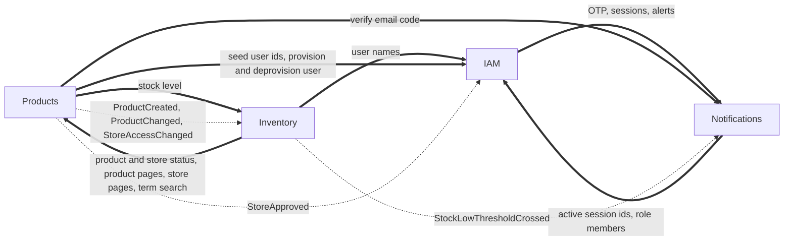

# Modules

This is the reference for what each module owns: routes and the permission each one needs, domain events, integration events, inter-module requests, scheduled jobs and settings. For the reasons behind the structure read [`ARCHITECTURE.md`](ARCHITECTURE.md). For the shared building blocks every module uses read [`platform.md`](platform.md).

## How modules fit together

| Module | Startup order | Kind | Test target |
| :-- | :-- | :-- | :-- |
| BackgroundJobs | 0 | Core, always loads | `make test-backgroundjobs` |
| Outbox | 1 | Core, always loads | `make test-outbox` |
| IAM | 2 | Optional | `make test-iam` |
| Notifications | 3 | Optional | `make test-notifications` |
| Products | 4 | Optional | `make test-products` |
| Inventory | 5 | Optional | `make test-inventory` |

Optional modules are enabled by `ModulesOptions.EnabledModules` in `src/Host/Host/Configurations/modules.json`. The value `"*"` enables all of them. Core modules load in every process because the transactional write path depends on them.

Every business module follows the same layout: `{M}.Domain` (aggregates, `DomainEvents/v1`, errors, ids), `{M}.Application` (`I{M}DbContext`, event handlers), `{M}.Endpoints` (feature folders and `{M}Module.cs`), `{M}.Infrastructure` (DbContext, EF configuration, inter-module request handlers, telemetry, migrations) and `{M}.Tests`.

Which module talks to which:

Solid arrows are synchronous inter-module requests, dashed arrows are integration events. Both travel over RabbitMQ.

---

## IAM

Identity and access, brokered through Keycloak. IAM has no database: Keycloak owns users, roles, sessions and permissions, and the API asks it for decisions. The self-service routes that exist depend on `IdentitySchemeOptions.Scheme` (`identityScheme.json`), a one-time choice per deployment.

| Method and path | Needs | Notes |
| :-- | :-- | :-- |
| `POST /otp/login` | anonymous | Sends a login code. PhoneNumber scheme only. Rate policy `Sms`. |
| `POST /otp/registration` | anonymous | Sends a registration code. PhoneNumber scheme only. Rate policy `Sms`. |
| `POST /otp/email` | anonymous | Sends an email code. Both schemes. Rate policy `Email`. |
| `POST /otp/email/verify` | anonymous | Verifies an email code and returns a verification token. Both schemes. Rate policy `OtpVerify`. |
| `POST /tokens` | anonymous | Phone number and code for tokens. PhoneNumber scheme only. Rate policy `TokenCreate`. |
| `POST /tokens/email` | anonymous | Email, password and verification token for tokens. Both schemes (staff sign in this way). Rate policy `TokenCreate`. |
| `POST /tokens/refresh` | anonymous | Rotates the refresh token. Rate policy `TokenRefresh`. |
| `POST /tokens/revoke` | `sessions:revoke-own` | Revokes the caller's current session. |
| `GET /tokens/sessions` | `sessions:view-own` | Lists the caller's sessions. |
| `DELETE /tokens/sessions/{id}` | `sessions:revoke-own` | Revokes one session. |
| `POST /tokens/sessions/revoke-all` | `sessions:revoke-own` | Signs out everywhere. |
| `POST /users/register/self` | anonymous | Phone self-registration. PhoneNumber scheme only. Rate policy `Register`. |
| `GET /users/check-registration` | anonymous | Tells whether a phone number is registered. PhoneNumber scheme only. |
| `POST /users/register/self/email` | anonymous | Email self-registration. Email scheme only. |
| `GET /users/me` | `users:view-own` | The caller's profile, roles and permissions. |
| `GET /users/{id}` | `users:view` | Any user. |
| `GET /users/search` | `users:search` | Searches users. |
| `GET /captcha/client-key` | anonymous | The public captcha key. Gated by the `IAM.Captcha` feature flag. |

**Serves** inter-module requests: `GetSeedUserIds`, `GetActiveSessionIds`, `GetUsersInRolePage` (a reconciliation pager over the effective members of a realm role, see below), `GetUsers` (email, first and last name and phone number for a list of user ids, one request per page, cached per user for a day in-process and, when Redis is configured, in Redis; the phone number is the one a module messages, so a caller that only shows names ignores it), `ProvisionUser` (creates an identity-provider account with the baseline `basic` role and no business role) and `DeprovisionUser` (the compensation for a registration whose local write failed; a user that is already gone is not an error). `ProvisionUserRequest` carries `EncryptedPassword`, the password encrypted with `SecretProtector` (a message on the bus is visible in broker queues, error queues and logs, so it never travels in clear). The provisioned user has a verified email (the caller proved it) and `phoneNumberVerified=false`. `CreateKeycloakUser` has explicit `PhoneNumberVerified` and `EmailVerified` flags, both false by default, and the OTP-verified self-registration flows pass true for what they verified.
**Role members.** `GetUsersInRolePage` lists the enabled users who hold the role directly, hold a realm role that includes it (a user holding only `system-admin` is a member of `staff`) and belong to a group (or a sub-group) that carries the role or such a containing role. The Admin REST reads behind it are `GetRolesContainingAsync` and `GetUsersInGroupsHoldingRolesAsync` of the admin client. The members are one deduplicated sequence in a fixed order. A role with no indirect holders is paged straight through Keycloak. A role with indirect holders is built once into a list that is kept in memory (never Redis) for `KeycloakOptions.RoleGraphCacheSeconds`, together with the realm role graph, and every page of a walk is a slice of that list. Limits: nothing evicts the list but its expiry, so a member added meanwhile appears in the next window; a "no indirect holders" verdict for a role is cached for the same window, so a role that gains its first indirect holder is read directly until the window ends; and the list has no size cap, so the whole member list of a role with indirect holders sits in memory on every node that serves the request for that time.
**Consumes** `StoreApprovedIntegrationEvent` and grants the `store-owner` realm role to the store's owner. The realm policy `Store Owner Role Policy` keys on that role and binds `warehouse-connections:connect` (`Warehouse Connections Store Owner Permission`), so an owner can connect their own store. Every `-own` permission still applies `Any Authenticated User Policy` and the route decides ownership in its query (for example `GET /v1/warehouse-connections/my` joins the store access copy), because `PermissionCoverageTests` rejects an `-own` permission without that policy. The API keeps the permissions Keycloak granted for a token's life, so an owner who was approved after signing in is recognised only by a token issued after the role was assigned: refresh the token or sign in again. The role is also what the Notifications hub joins a connected owner's group by. IAM has no database, so the consumer uses `StatelessInboxStore` and relies on Keycloak's role mapping being idempotent. An owner Keycloak no longer knows is logged and skipped. If the role is missing from the realm the consumer throws and the bus retries, so a realm imported before the role existed needs it created by hand (see [`keycloak/README.md`](../keycloak/README.md)).
**Calls** Notifications for OTP sending and verification, verification tokens, device session binding and security alerts.
**Settings**: `keycloak.json`, `identityScheme.json`, `captcha.json`, `devices.json`, and the `Register`, `Sms`, `Email`, `OtpVerify`, `TokenCreate`, `TokenRefresh` and `CheckRegistration` entries of `rateLimiting.json`. The user lookup is tuned by four fields of `KeycloakOptions` and the role member read by a fifth:

| Setting | Meaning |
| :-- | :-- |
| `UserLookupConcurrency` | Most Keycloak `GET /users/{id}` calls one `GetUsers` request has in flight for its cache misses |
| `UserDisplayCacheDurationSeconds` | In-process lifetime of one user's cached display data |
| `UserDisplayCacheDistributedDurationSeconds` | Redis lifetime of the same entry. Long on purpose, a name changes only from the Keycloak console. Must be at least the in-process lifetime |
| `UserDisplayNegativeCacheDurationSeconds` | Lifetime of the entry cached for an id Keycloak does not know, so repeated lists do not ask again |
| `RoleGraphCacheSeconds` | In-memory lifetime of the realm role graph and of the effective member list of a role that has indirect holders |

How a login works. The backend verifies the one-time code itself (through Notifications), then calls Keycloak's `trusted-login` direct-grant flow, which has no credential step. That is why the `backend-trusted-login` client secret is as sensitive as every user's password. See [`keycloak/README.md`](../keycloak/README.md).

Things you will want to adapt in a fork: the default culture is Turkish (`localization.json`), and the email registration validators accept first and last names made of Turkish-alphabet letters and spaces only (`ContainsOnlyTurkishCharacters` in `SelfRegisterByEmail/Request.cs`).

## Products

A standard DDD module and the exemplar to copy when writing a new one: stores, product templates and products. Read endpoints project straight to DTOs. Write endpoints go through the aggregate. It also carries the accept-queue-poll job family (product import and export), product images, and the store application and approval lifecycle.

Routes live under `/v1`. The "my" routes act on the caller's own store and need the `-own` scopes.

| Method and path | Needs |
| :-- | :-- |
| `POST /v1/stores` | `stores:create` |
| `GET /v1/stores/{id}` | `stores:view`. An Active store only, any other status is a 404 |
| `PUT /v1/stores/{id}` | `stores:update` |
| `POST /v1/stores/{id}/deactivate` | `stores:update` |
| `GET /v1/stores/search` | `stores:search`. Active stores only |
| `GET /v1/stores/administration` | `stores:view-all`. Stores in any status, newest first, optional `Status` filter |
| `GET /v1/stores/{id}/audit-log` | `stores:view` |
| `POST /v1/stores/{id}/products` | `products:create` |
| `DELETE /v1/stores/{id}/products/{productId}` | `products:delete` |
| `POST /v1/stores/applications` | anonymous. Rate policy `StoreApplication`. Needs an email verification token |
| `GET /v1/stores/applications` | `stores:approve` |
| `GET /v1/stores/applications/{id}` | `stores:approve`. One application that waits for a decision |
| `POST /v1/stores/{id}/approve` | `stores:approve` |
| `POST /v1/stores/{id}/suspend` | `stores:suspend` |
| `POST /v1/stores/{id}/reinstate` | `stores:reinstate` |
| `POST /v1/stores/my` | `stores:create-own`. Rate policy `CreateStore` |
| `GET /v1/stores/my` | `stores:view-own` |
| `PUT /v1/stores/my` | `stores:update-own` |
| `GET /v1/stores/my/audit-log` | `stores:view-own` |
| `POST /v1/stores/my/products` | `products:create-own` |
| `DELETE /v1/stores/my/products/{id}` | `products:delete-own` |
| `GET /v1/products/{id}` | `products:view` |
| `PUT /v1/products/{id}` | `products:update` |
| `GET /v1/products/search` | `products:search` |
| `GET /v1/products/{id}/audit-log` | `products:view` |
| `GET /v1/products/my/{id}` | `products:view-own` |
| `PUT /v1/products/my/{id}` | `products:update-own` |
| `PUT /v1/products/my/{id}/attributes` | `products:update-own` |
| `PUT /v1/products/my/{id}/package-dimensions` | `products:update-own` |
| `GET /v1/products/my/search` | `products:search-own` |
| `POST /v1/products/{id}/images` | `products:update-own`. Multipart upload of one JPEG, PNG or WebP |
| `DELETE /v1/products/{id}/images/{imageId}` | `products:update-own` |
| `POST /v1/products/imports` | `products:import-own`. Multipart upload of a spreadsheet, answers 202 |
| `GET /v1/products/imports` | `products:import-own`. The caller's jobs, newest first |
| `GET /v1/products/imports/{id}` | `products:import-own` |
| `POST /v1/products/exports` | `products:export`. Answers 202 |
| `GET /v1/products/exports/{id}` | `products:export` |
| `GET /v1/products/exports/{id}/download` | `products:export`. The finished CSV file |
| `POST /v1/product-templates` | `product-templates:create` |
| `GET /v1/product-templates/{id}` | `product-templates:view` |
| `GET /v1/product-templates/search` | `product-templates:search` |
| `POST /v1/product-templates/{id}/activate` | `product-templates:update` |
| `POST /v1/product-templates/{id}/deactivate` | `product-templates:update` |
| `GET /v1/probe/cross-module` | anonymous |

`GET /v1/products/{id}` returns `availableQuantity`, filled by a synchronous request to Inventory. If Inventory is down or has not consumed the creation event yet, the field is `0` and the read still succeeds. `GET /v1/probe/cross-module?count=N` exists to prove a cross-process call (see [`split-deployment-poc.md`](split-deployment-poc.md)).

**Store application and approval.** `Store.Create` opens an `Active` store (the admin and "my" create routes). `POST /v1/stores/applications` is the anonymous path. The applicant first proves they own the email address: the body carries `emailVerificationToken`, the single-use token `POST /otp/email/verify` returns after the mailed code, and the endpoint checks it through Notifications (`VerifyEmailOtpRequest`, so the Notifications module must be loaded) and consumes it before anything is created. A token issued for an address that already has a user answers `409 EmailAlreadyRegistered`; any other unknown token is `InvalidEmailVerificationToken`. Then the endpoint creates the owner's identity-provider account through `ProvisionUser` (the password is sent encrypted), saves a store in `PendingApproval`, and returns neither a role nor a token. If the save fails after the account exists, the endpoint sends `DeprovisionUser` so a retry does not collide with a half-created account (the compensation exception named in `CLAUDE.md` section 3). Because the token is single use, a later failure (a weak password, a taken phone number) needs a fresh email code. Known limit: an unauthenticated caller can burn the attempts of a pending login token through this route, the same exposure as the email login. `approve` moves `PendingApproval` to `Active` and raises `StoreApprovedIntegrationEvent`, from which IAM grants the `store-owner` role. `suspend` moves an `Active` store to `Suspended`, `reinstate` moves a `Suspended` one back, and `deactivate` is final (on a `PendingApproval` store it rejects the application; it raises the event that says whether products still had stock on hand, which needs the store's stocked products loaded). Each transition is idempotent when the store is already in the target state. The anonymous route is limited per client IP by the `StoreApplication` policy (5 per hour by default) and its body is redacted from request logs (`requestLogging.json`).

**Store status gate.** Only an `Active` store changes or takes products. `Store.Update`, `AddProduct`, `RemoveProduct` and the `Store.UpdateProduct`, `SetProductAttributes`, `SetProductPackageDimensions`, `AddProductImage` and `RemoveProductImage` methods first ask `Store.EnsureActive()`; for a store in another status the route answers 409 `StoreIsPendingApproval`, `StoreIsSuspended` or `StoreIsInactive` and changes nothing. The `Product` mutators are `internal`, so no endpoint can change a product without that gate; the endpoints load the product together with its store. `POST /v1/products/imports` for a store that is not Active is refused 409 before the upload is stored, and a row of an import already running meets the same gate (the row is rejected with that key). `GET /v1/stores/{id}` and `GET /v1/stores/search` show Active stores only; `GET /v1/stores/administration` is the listing of every status.

**Products**: a product may carry a `Sku` (the store's own code, unique within the store, set at creation and never changed; a duplicate answers `SkuAlreadyExists`), a list of name and value attributes (replaced whole through `PUT .../attributes`, at most `MaxAttributesPerProduct`, names unique without regard to case, stored as one jsonb column) and package dimensions (`PUT .../package-dimensions`: length, width and height in cm and weight in kg, each above zero and at most 1000, held by an owned value object in the product's row). The price floor (`Constants.PriceGreaterThanOrEqualTo`, 1) is inclusive: a price equal to it is accepted by the create, update and search validators and by the import. Every write to a product goes through the store status gate above.

**Images**: `POST /v1/products/{id}/images` takes one multipart file of at most `ImageMaxFileBytes`. The type (JPEG, PNG or WebP) is read from the file's first bytes, never from its name. The object goes to the public store under a content-hash key, the row is saved afterwards, and the answer carries the image id and its public URL. A product holds at most `MaxImagesPerProduct` images. Removing one image (`DELETE .../images/{imageId}`) or a whole product that has images publishes `ProductImageObjectsOrphanedIntegrationEvent(ProductId, ObjectKeys)` in the same save as the removal; the Products consumer (`DeleteOrphanedProductImageObjectsHandler`) deletes those objects from the public store, treats an object that is already gone as done, and keeps any key an image row points at again by then. A crash between the removal and the deletion therefore never leaves a file behind.

**Import** (`POST /v1/products/imports`, form fields `File`, `ClientRequestId`, `ProductTemplateId`). The endpoint checks only the size and the extension (`.xlsx` or `.xls`), stores the workbook in the private object store, writes a `ProductImportJob` row and one `ProductImportRequestedIntegrationEvent` in the same transaction and answers 202 with the job. The caller's store has to be `Active`: any other status answers 409 with that status's error before the file is stored. The queue consumer upserts the products of the caller's own store from the first worksheet (row 1 is the header; columns: A name, B description, optional, C quantity, D price, E SKU, optional), in batches of `BulkImportOptions.SaveChunkSize` rows, at most `ImportBatchesPerMessage` batches per message; a larger file continues in a message the job queues for itself. A row with a SKU is matched by the SKU first (it names one product); a row without one is matched by name, and a name shared by several products is rejected as `AmbiguousProductName` instead of updating one of them by chance. The job records the uploader's culture (`UiCulture`) and the consumer runs under it, because a consumer has no request and the search language stamped on a new product comes from the current culture. A repeated `ClientRequestId`, or an import already active for the caller, returns the existing job. A job is `Queued`, `Running`, `Succeeded` or `Failed`. `Failed` carries a `FailureKey` (`TooManyRows`, `FileUnreadable`, `NotFound`, `JobStale`, `UnexpectedError`). A `Succeeded` job lists the rows it rejected, up to `ImportMaxStoredRowErrors`, each as a row number and a reason key (`MissingName`, `NameTooLong`, `DescriptionTooLong`, `InvalidQuantity`, `InvalidPrice`, `SkuTooLong`, `SkuDiffers`, `SkuAlreadyExists`, `AmbiguousProductName`, `ConcurrentUpdate`, or the store status key when the store stopped being Active while the file ran); the other rows are imported. The uploaded workbook is deleted when the job finishes.

**Export** (`POST /v1/products/exports`, optional `StoreId` query). The same shape: a `ProductExportJob` row, one `ProductExportRequestedIntegrationEvent`, 202 with the job. The consumer reads the products created up to the moment of the request in keyset pages of `ExportPageSize`, writes a CSV (UTF-8 with a byte order mark; columns `Name,Description,Quantity,Price,Sku,Id,StoreId,CreatedOn`, so the first five are the columns the import reads, in its order) and stores it in the private store. Spreadsheet formula injection is guarded by `FormulaGuard`: a text cell that starts with `=`, `+`, `-`, `@`, a tab or a carriage return is written with a leading apostrophe, and the import strips exactly one apostrophe from a text cell that starts with apostrophes and then one of those characters, so a name such as `-5 degree sock` survives the round trip (a name that already starts with apostrophes before a formula character gets one more on export). Any other text, even one that merely starts with an apostrophe, passes both ways unchanged. To re-import an export: open the CSV in a spreadsheet, save it as `.xlsx`, and upload that file. More than `ExportMaxRows` products fails the job with `RowLimitExceeded`. `GET .../exports/{id}/download` answers the file once the job is `Succeeded` and 409 `NotReady` before that; another user's job is a 404. One import and one export can each be active per user at a time.

Finished job rows and their files are removed after `JobHousekeepingOptions.RetentionHours`, and a `Running` row nobody finished is failed with `JobStale` after `StaleAfterMinutes` (`ProductJobsHousekeeping`, cron `ProductsOptions.JobHousekeepingCron`).

**Aggregates**: `Store` (with a status and a list of products), `Product`, `ProductTemplate`. Domain events are versioned and frozen (`V1ProductCreatedDomainEvent`, `V1ProductPriceIncreasedDomainEvent`, `V1StoreCreatedDomainEvent`, `V1StoreEmptiedDomainEvent`, `V1ProductAddedToStoreDomainEvent` and others in `Domain/*/DomainEvents/v1`, plus the application lifecycle events `V1StoreApplicationSubmittedDomainEvent`, `V1StoreApprovedDomainEvent`, `V1StoreSuspendedDomainEvent` and `V1StoreReinstatedDomainEvent`, and `V1ProductImagesRemovedWithProductDomainEvent` for the object keys of a removed product's images). `V2StoreAddressUpdatedDomainEvent` in `Domain/Stores/DomainEvents/v2` replaces the V1 address event for new changes and adds the previous address; the V1 record stays so old audit rows still read.
**Publishes** integration events: `ProductCreatedIntegrationEvent`, `StoreCreatedIntegrationEvent`, `ProductChangedIntegrationEvent` (on creation and on a name change; it carries the product's `Version` so a consumer drops a stale event), `StoreApprovedIntegrationEvent`, `StoreAccessChangedIntegrationEvent(StoreId, OwnerId, IsActive, Version)`, `ProductImageObjectsOrphanedIntegrationEvent` and the two queue messages above, which only Products consumes (so does the orphaned-objects event). The access event is queued from every store event that opens or closes the store for its owner (created, approved, suspended, reinstated, deactivated, and deactivated with stock on hand); the submission of an application queues none, because a pending store is not active. Its `Version` is the domain event's own. Inventory consumes the first, the third and the access event, IAM the fourth.
**Serves** `GetProduct`, `GetProductsPage` (one keyset page of every product, newest first, capped at `ProductsPageMaxSize`; the source of Inventory's nightly reconciliation, never a request path), `GetStoresPage` (the same for stores: newest first by store id, capped at `StoresPageMaxSize`, each item holding the owner, whether the store is `Active` and the store's `Version`; the source of Inventory's store access reconciliation, never a request path) and `SearchProductsByTerm` (free-text match on a product name or description, at most `FullTextSearchOptions.MaxMatchResults` ids, with an `IsTruncated` flag, cached for `SearchCacheSeconds`). **Calls** `GetStockLevel` (Inventory), `GetSeedUserIds` (IAM, for seeding and the probe), `ProvisionUser` and `DeprovisionUser` (IAM, for store applications) and `VerifyEmailOtp` (Notifications, for the email ownership proof of a store application).
**Seeding**: a seeder creates sample stores, product templates and products after startup.
**Settings**: the `CreateStore` rate limit policy in `rateLimiting.json` limits `POST /v1/stores/my` per user (one store creation per week by default). The admin route `POST /v1/stores` is not limited by it, because it creates stores on behalf of other owners. Full-text search settings are in `fullTextSearch.json`. The job and image settings are in `products.json` (`ProductsOptions`) and `bulkImport.json` (`BulkImportOptions`, shared with the Inventory bulk adjustment):

| Setting | Meaning |
| :-- | :-- |
| `ProductsOptions.ImportJobConcurrentMessageLimit` | Import messages one process works on at once. Also the consumer's prefetch count |
| `ProductsOptions.ImportBatchesPerMessage` | Batches one import message saves before the job queues a continuation for itself |
| `ProductsOptions.ImportMaxStoredRowErrors` | Rejected rows kept on a job. The rest are only counted |
| `ProductsOptions.ExportJobConcurrentMessageLimit` | Export messages one process works on at once. Also the prefetch count |
| `ProductsOptions.ExportPageSize` | Products read per keyset page while an export is built |
| `ProductsOptions.ExportMaxRows` | An export of more products fails, the file is built in memory |
| `ProductsOptions.JobHousekeepingCron` | When the housekeeping of both job tables runs |
| `ProductsOptions.ImageMaxFileBytes`, `MaxImagesPerProduct` | Image upload limits |
| `ProductsOptions.MaxAttributesPerProduct` | Most attributes one product may carry |
| `ProductsOptions.ProductsPageMaxSize` | Largest page `GetProductsPage` returns, whatever the caller asks for |
| `ProductsOptions.StoresPageMaxSize` | Largest page `GetStoresPage` returns, whatever the caller asks for. A caller checks the next cursor, never its own page size |
| `ProductsOptions.SearchCacheSeconds` | How long a `SearchProductsByTerm` answer is cached. 0 turns the cache off |
| `BulkImportOptions.MaxFileBytes`, `MaxRows`, `SaveChunkSize` | Upload size ceiling, data rows allowed in one workbook, rows saved per batch |
| `FullTextSearchOptions.MaxMatchResults` | Cap on ids a cross-module term search returns |
| `JobHousekeepingOptions` (`jobHousekeeping.json`) | `StaleAfterMinutes`, `RetentionHours`, `PageSize` for every job table |
| `CustomRateLimitingOptions.StoreApplication` | Fixed window of the anonymous store application, per client IP |

## Inventory

Stock levels, stock reservations and warehouse connections. It is the advanced exemplar: a saga-shaped aggregate, an immutable stock ledger with low stock thresholds, per-store warehouse connections with encrypted credentials behind a per-provider gateway with its own resilience and an address guard, an HMAC-signed webhook that applies each delivery once, a dirty-set stock push, a queued bulk adjustment, a local product projection and a local store access projection that gate the owner's reads, sweep jobs and cross-module wiring in both directions.

Routes live under `/v1`. An administration route asks a `-view-all` scope (held by the `system-admin` role). Its owner twin under `my` asks the `-view-own` scope (held by every authenticated user) and reads only the data of the active stores the caller owns, through Inventory's own copy of store access (see "Store access projection" below). Data outside that set is a 404 or an empty page, never a 403. The old `stock-levels:view` and `stock-reservations:view` scopes no longer exist.

| Method and path | Needs |
| :-- | :-- |
| `GET /v1/stock-levels` | `stock-levels:view-all`. Every store's stock levels |
| `GET /v1/stock-levels/{id}/movements` | `stock-levels:view-all` |
| `GET /v1/stock-levels/daily-totals` | `stock-levels:view-all`. Query `storeId`, `from`, optional `to` (dates) |
| `GET /v1/stock-levels/my` | `stock-levels:view-own`. The stock levels of the active stores I own, same filters and paging |
| `GET /v1/stock-levels/my/{id}/movements` | `stock-levels:view-own` |
| `GET /v1/stock-levels/my/daily-totals` | `stock-levels:view-own`. Same query as the administration read, for one of my active stores |
| `POST /v1/stock-levels/{id}/receive` | `stock-levels:update` |
| `POST /v1/stock-levels/{id}/adjust` | `stock-levels:update` |
| `PUT /v1/stock-levels/{id}/low-stock-threshold` | `stock-levels:update` |
| `POST /v1/stock-levels/bulk-adjustments` | `stock-levels:update`. Multipart upload of a spreadsheet, answers 202 |
| `GET /v1/stock-levels/bulk-adjustments` | `stock-levels:update`. The caller's jobs, newest first |
| `GET /v1/stock-levels/bulk-adjustments/{id}` | `stock-levels:update` |
| `POST /v1/warehouse-connections` | `warehouse-connections:create`. Any store |
| `POST /v1/warehouse-connections/my` | `warehouse-connections:connect`, held by the `store-owner` role (`Store Owner Role Policy`). Same body and answer; connects one of the active stores I own, anything else is a 404 |
| `GET /v1/warehouse-connections` | `warehouse-connections:view` |
| `GET /v1/warehouse-connections/{id}` | `warehouse-connections:view` |
| `GET /v1/warehouse-connections/my` | `warehouse-connections:view-own`. The caller's connections of active stores they own |
| `PUT /v1/warehouse-connections/{id}/credentials` | `warehouse-connections:update` |
| `POST /v1/warehouse-connections/{id}/rotate-webhook-secret` | `warehouse-connections:update` |
| `POST /v1/warehouse-connections/{id}/deactivate` | `warehouse-connections:update` |
| `POST /v1/stock-reservations` | `stock-reservations:create` |
| `POST /v1/stock-reservations/series` | `stock-reservations:create` |
| `GET /v1/stock-reservations/{id}` | `stock-reservations:view-all`. Carries `isReadOnly`, `providerStatus` and `hasPendingReleaseAttempt` |
| `GET /v1/stock-reservations/my` | `stock-reservations:view-own`. The reservations of the products of the active stores I own, newest first; filters `ProductId` and `Status`; offset or `after` cursor |
| `GET /v1/stock-reservations/my/{id}` | `stock-reservations:view-own`. The same answer as the administration read |
| `POST /v1/stock-reservations/{id}/commit` | `stock-reservations:update` |
| `POST /v1/stock-reservations/{id}/release` | `stock-reservations:update` |
| `POST /v1/stock-reservations/{id}/reconcile-release` | `stock-reservations:update`. Resolves a release whose outcome is unknown. Answers `Released`, `NotReleased` or `AlreadyReleased` |
| `POST /v1/stock-reservations/{id}/resolve-read-only` | `stock-reservations:update`. Body `targetStatus` (`Released`, `Committed` or `Expired`) and, to commit, `providerReference`. 204 |
| `POST /v1/stock-reservations/webhooks/warehouse/{connectionId}` | anonymous, authenticated by the `X-Warehouse-Signature` HMAC-SHA256 header made with that connection's webhook secret. Rate policy `WarehouseWebhook` |

A `StockReservation` moves through `Active`, `Committed`, `Released`, `Expired` and `RequiresReconciliation`. The last state is reached when a commit arrives with a different provider reference than the one already recorded, which is never resolved automatically.

**Status the warehouse system also reports.** The legal moves live in one table, `ReservationStatusTransitions`: `Active` to `Committed`, `Released` or `Expired`, and `Committed` to `RequiresReconciliation`. Every other status is final, and a move to the same status is an idempotent no-op that the command answers before it asks the table. `ProviderStatusMap` is the one place the provider's words are spelled (`held`, `confirmed`, `released`, `expired`, case-insensitive, mapped to `Active`, `Committed`, `Released`, `Expired`); a delivery without a status is the original confirmation. A mapped word reaches the reservation as the command a local caller would use (`Commit`, `Release`, `Expire`), so every rule of those commands holds, and `held` changes nothing. A word nobody mapped never fails the delivery: it is acknowledged, recorded (cut at 64 characters) in `V1StockReservationProviderStatusUnrecognizedDomainEvent` and so in the audit trail, and the reservation turns read-only. A read-only reservation takes no local command until a person resolves it: `Commit`, `Release`, `Expire` and the release attempt commands answer 409 `ReservationReadOnly`, its own `Status` stops following the provider, and `providerStatus` keeps mirroring the last word (`Unknown` while that word is unmapped; a changed mirror raises `V1StockReservationProviderStatusMirroredDomainEvent`). `POST /v1/stock-reservations/{id}/resolve-read-only` is that decision: after checking at the warehouse system what the reservation really is, the caller names the target (`Released`, `Committed` or `Expired`). The reservation takes local commands again and is brought to the target by the command a local caller would use, so its rules hold (a commit needs a `providerReference` and a deadline that has not passed) and `ReservationStatusTransitions` decides whether the move exists; a target equal to the status it already has only lifts the flag, and a refusal changes nothing and leaves it read-only. A reservation that is not read-only answers 409 `NotReadOnly`, a target outside the three is `ResolutionNotAllowed`. The result is recorded in `V1StockReservationReadOnlyResolvedDomainEvent`. `ReservationStatusTransitionsTests` holds the table to the documented moves, and `StockReservationTests` checks after each command that a change of status is a move the table lists and that an event was raised exactly when a field changed.

**Ordering of deliveries.** A delivery may carry `occurredOn`, the warehouse system's own timestamp. Statuses are applied in the order of that timestamp, not of arrival: a delivery stamped earlier than the latest stamped one already applied is acknowledged as stale (204) and changes nothing, and the latest applied stamp is kept on the reservation (`V1StockReservationProviderEventTimeRecordedDomainEvent`). A delivery without `occurredOn` is applied in arrival order and never moves the stamp. A stamp further ahead of this system's clock than `WebhookMaxFutureSkewSeconds` is refused 400 `WebhookOccurredOnInTheFuture` before anything is recorded, because applying it would make every later delivery of that reservation stale; the setting only has to cover the warehouse system's clock drift. `status` may be any JSON kind (a number, a boolean, an object or an array is a word nobody mapped, not a malformed body), and `null` or absence is the original confirmation.

- **Reserve** creates an active reservation with a deadline. A reservation is a request to the warehouse system, which is the authority on availability: the local stock level mirrors it, and `Reserve` does not check the local quantity.
- **Reserve series** creates one reservation per occurrence, spaced `IntervalDays` apart from `FirstDeadline`. Only the first occurrence carries the extra `SafetyBufferQuantity`. It asks Products over an inter-module request whether the product exists and its store is active. The per-warehouse allocation in the request is validated but not stored yet.
- **Commit** records the warehouse system's confirmation. A webhook that lands between the read and the save changes the same row, so the save goes through `ApplyAndSaveAsync` (`StockReservationWrites`): on a lost race the reservation is read again and the commit applied once more (a repeat of the recorded reference is a no-op, another reference is flagged `RequiresReconciliation`) instead of answering 409.
- **Release** resolves the gateway of the product's store from its active warehouse connection, persists an attempt marker (with its time), calls the warehouse, then persists the outcome in a second save. The call carries the reservation id as the release's reference and idempotency key (see the wire table). A store without an active connection leaves no marker behind. The endpoint is deliberately imperative to keep that order crash-safe. The outcome is saved through `ApplyAndSaveAsync` too: a release the warehouse confirmed is a fact even if a webhook meanwhile turned the reservation read-only, in which case the release is only mirrored into `providerStatus` and the marker cleared.
- **Reconcile release** (`POST .../reconcile-release`, and a sweep) resolves an attempt marker whose outcome is unknown: a timeout (504 `WarehouseGatewayOutcomeUnknown`) or a request that ended between the call and the save. `StockReleaseReconciler` asks the warehouse, through the gateway's idempotent reconcile call and the reservation id, what became of the release. If the warehouse says it released the hold, the release is completed locally (outcome `Released`); if it says it knows no such release, the marker is dropped so a release can be tried again (`NotReleased`); a reservation already released answers `AlreadyReleased` without asking. Any other answer, a timeout or a bare 404 (a wrong base address, not a missing release) is a failed result that leaves the marker for the next attempt; a reservation without a marker answers 409 `NoReleaseAttempt`. The sweep (`StockReleaseReconcileSweepService`, cron `StockReleaseReconcileSweepCron`) finds writable active reservations whose marker is older than `StockReleaseReconcileMinAgeSeconds` (a marker younger than that belongs to a request still waiting, one with no time counts as old) and publishes one `StockReleaseReconcileRequestedIntegrationEvent` each, `SweepPageSize` at a time. It never calls the warehouse; the queue consumer (`ReconcileStockReleaseHandler`) does, and logs and acknowledges any expected failure.
- **Expiry sweep** is a scheduled job that expires overdue reservations in batches.

**Stock levels and the ledger.** A `StockLevel` is created when `ProductCreatedIntegrationEvent` arrives. Its quantity changes only through three commands, and each appends one immutable `StockMovement` row (type, signed quantity, quantity after, reason, and the reservation id for a deduction): `receive` (positive quantity), `adjust` (signed, never zero, a reason is mandatory) and the deduction for a committed reservation. A change that would take the quantity below zero is refused with `InsufficientStock`. A row is never edited or deleted; a mistake is corrected by a new `Adjusted` row, and `StockMovementWriteGuardTests` keeps the `StockLevel` aggregate the only writer. Each row carries a `Sequence`, the next number of a counter the stock level keeps, unique per stock level (a unique index on `(StockLevelId, Sequence)`): the ids of a save share a timestamp and are random inside a millisecond, so the sequence is what gives the rows of one save a stable order. `GET .../{id}/movements` (and `my/{id}/movements`) pages the ledger newest first by sequence with the `After` cursor, shows the sequence, and names the acting users with one IAM `GetUsers` request per page (a movement made by a consumer has no actor; when IAM does not answer the page still returns, with ids only). A cursor minted before the sequence existed, or for another sort key, is refused as a validation failure. The migration backfills existing rows per stock level ordered by creation time and then by id, and starts each counter from its row count, so the order of old rows that tie on creation time is by id.

**Low stock threshold.** `PUT .../{id}/low-stock-threshold` sets it (0 means no alert). A movement that takes the quantity from at or above the threshold to below it raises `V1StockLowThresholdCrossedDomainEvent` once, not once per movement below it; going back to at or above raises `V1StockLowThresholdRecoveredDomainEvent`. Changing the threshold across the current quantity counts as a crossing too. The handlers publish `StockLowThresholdCrossedIntegrationEvent` and `StockLowThresholdRecoveredIntegrationEvent`. Notifications consumes the crossed event and raises a critical alert from it (see [Notifications](#notifications)); the recovered event is a published fact that no module consumes in this repository.

**Stock list and the product projection.** `GET /v1/stock-levels` lists stock levels, least stock first, with each product's name from `ProductSummary`, Inventory's local copy of the product facts it needs (store id and name). The join is a native `LEFT JOIN`, so a level whose product is not projected yet is listed with a null name. `ProductName` narrows the list to the ids Products matches through `SearchProductsByTerm`; `IsTruncated` in the answer says that match list was cut at `MaxMatchResults`. Paging is by offset or by the `after` cursor (`PaginateKeyedAsync`, sort key the stock quantity and the id as tiebreaker). `GET /v1/stock-levels/my` runs the same code over the stock levels of the caller's active stores. `ProductSummary` is fed by `ProductChangedIntegrationEvent` through `UpsertIfNewerAsync` and healed by `ProductSummariesReconciliationJob`, which pages Products' `GetProductsPage`. The copy is also what links a product to its store, so a movement or a release finds the store's warehouse connection through it.

**Committed reservations.** A commit, from the endpoint or from the webhook, raises `V1StockReservationCommittedDomainEvent`, which publishes `StockReservationCommittedIntegrationEvent`. Two consumers inside Inventory react. `DeductStockOnReservationCommittedHandler` loads the product's stock level under `SELECT ... FOR UPDATE` in an explicit transaction and deducts; it is idempotent three ways (the inbox row, a ledger check under the lock, and a unique index on the ledger's reservation id), and a reservation that cannot be deducted is logged and acknowledged. `CountCommittedStockOnReservationCommittedHandler` adds the reservation to the store's `StoreDailyStockTotals` row for the business day with one atomic `INSERT ... ON CONFLICT DO UPDATE` (`InventoryOptions.BusinessTimeZoneId` decides where a day starts).

**Daily totals read.** `GET /v1/stock-levels/daily-totals?storeId=...&from=2026-03-01&to=2026-03-31` returns the `StoreDailyStockTotals` rows of that store, oldest day first, each as `day`, `committedReservations` and `committedUnits`. `from` and `to` are calendar days in the business time zone, both included, the same days the rows are keyed by; `to` is optional and defaults to today in that zone (`TimeProviderExtensions.GetToday`). A day with no committed reservation has no row. The range is capped at `InventoryOptions.DailyTotalsMaxRangeDays` days: a first day after the last day, an empty store id or a longer range answers 400. The administration read asks `stock-levels:view-all` (`system-admin`) and takes any store id. `GET /v1/stock-levels/my/daily-totals` takes the same query, asks `stock-levels:view-own` and reads only the totals of active stores the caller owns: a store that is not theirs, or not active, has no days.

**Warehouse connections.** A connection says how one store reaches its warehouse system: a `Provider` (`JsonApi`: JSON bodies and a bearer token; `FormApi`: form-encoded bodies and an `X-Api-Key` header; `Dummy`: an in-memory stand-in, see "Local development"), an absolute https `BaseUrl` and the credentials of both directions. A store has at most one active connection (unique index), and `Deactivated` is final. `POST` (the administration route for any store, `POST .../my` for the owner of an active store) generates the webhook secret and returns it exactly once, with the `WebhookPath` to give the warehouse system; the API credential and the webhook secret are stored encrypted by `SecretProtector` (key in `secretProtection.json`) and no endpoint returns either again. The bodies of `POST` and `PUT` requests under `/v1/warehouse-connections` (`apiCredential`) and the answers of the `POST` ones (create, create for my store, `rotate-webhook-secret`: `webhookSecret`) are never written to the request log (`requestLogging.json`). `credentials` replaces the API credential, `rotate-webhook-secret` issues a new secret (shown once, the old one stops verifying at once), and a deactivated connection takes no part in traffic. The gateway is built per call from the connection by `WarehouseGatewayFactory`, and every call goes through the connection's own Polly pipeline (rate limiter, circuit breaker, attempt timeout, no retry) built from the profile `Warehouse{Provider}` under `ResiliencyOptions.Keyed`, so one store's burst or outage cannot spend another store's quota or open its circuit. The pipeline has no retry on purpose: a release changes state at the warehouse, so a timeout surfaces as an unknown outcome (504 `WarehouseGatewayOutcomeUnknown`) and the attempt marker stays until it is reconciled. Our own quota or an open circuit stops a call before it is sent (429 `WarehouseGatewayThrottled`, 503 `WarehouseGatewayCircuitOpen`). A stored credential the current keys cannot open fails the gateway build with `WarehouseCredentialUnreadable` (a definite error, not an exception), see "Secret key rotation" below.

**Address policy (server-side request forgery guard).** The base address is typed in by a caller and then called by the server, so it is checked twice. The create validator (`WarehouseAddressPolicy.IsPublicHost`) refuses an address that is not absolute https, carries user info or a fragment, is `localhost` or a subdomain of it, or is an IP literal in a loopback, unspecified, private (10/8, 172.16/12, 192.168/16), shared (100.64/10), link-local (169.254/16, fe80::/10), unique-local (fc00::/7), benchmarking, multicast or reserved range (an IPv4 address carried inside an IPv6 one is judged as that IPv4 address). Because a name can point anywhere by the time it is called, the HTTP client of the gateway also checks on every connect (`WarehouseConnectGuard`): it resolves the host itself, refuses the whole host when any resolved address is not public (`WarehouseGatewayAddressNotAllowed`, 502, before a byte is sent) and connects to one of the addresses it just checked, so the lookup that was checked is the one used. That client follows no redirect and uses no proxy (`AllowAutoRedirect = false`, `UseProxy = false`). Known limit: because it uses no proxy, a deployment that can only reach the internet through an egress proxy cannot reach a warehouse system with this client; that needs another control, such as an allow-listed egress route for the host. `InventoryOptions.AllowPrivateWarehouseAddresses` (false) lifts both checks for a developer's stub and is rejected in Production by the options validator; the address must still be https, and the stub needs a certificate the host trusts.

**Secret key rotation.** Stored warehouse secrets are `SecretProtector` values (layout `version(1) || keyId(4) || nonce(12) || tag(16) || ciphertext`). To rotate: move the current `SecretProtectionOptions.EncryptionKey` to `PreviousEncryptionKeys`, set a new `EncryptionKey`, deploy, and let the sweep rewrite the stored values. The sweep (`WarehouseSecretReprotectSweepService`, cron `WarehouseSecretReprotectCron`) reads only the key id of each stored API credential and webhook secret and publishes one `WarehouseSecretsReprotectRequestedIntegrationEvent` (ids only) per page of `SweepPageSize` connections that hold a value under another key; the consumer (`ReprotectWarehouseSecretsHandler`) rewrites them under the current key with `WarehouseConnection.ReprotectSecrets` (event `V1WarehouseConnectionSecretsReprotectedDomainEvent`, a no-op when nothing needs rewriting). A value that cannot be opened is logged by connection id and secret name and skipped, never retried for ever, and no plaintext or stored value reaches a log. Drop the old key from `PreviousEncryptionKeys` only after the sweep has run and no value is left under it; a value whose key id is in neither place cannot be decrypted. A value stored in the layout that predates the version and key id header fails to open as well, so credentials stored by such a build are entered again (`PUT .../credentials`, `rotate-webhook-secret`).

**Store access projection and the `my` routes.** A store owner reads their own data without Inventory asking Products. `StoreAccess` is Inventory's copy of each store's owner and active flag, keyed by the Products store id and fed by `StoreAccessChangedIntegrationEvent` through `UpsertIfNewerAsync`, so an event that arrives late is dropped as stale. Every owner route joins to the rows whose owner is the caller and whose store is active, through one query helper per kind of data (`WarehouseConnectionQueries.OfActiveStoresOwnedBy`, `StockLevelQueries.StockLevelsOfActiveStoresOwnedBy` and `DailyTotalsOfActiveStoresOwnedBy`, `StockReservationQueries.StockReservationsOfActiveStoresOwnedBy`); stock levels and reservations reach the store through `ProductSummary` first, so a product that is not projected yet is invisible to its owner until it is. A store that is not active, or one the copy has not seen yet, yields no rows: an empty page, or a 404 for a single item, never a 403. Each owner route runs the code of its administration twin over the helper's query, so the two cannot drift. `POST /v1/warehouse-connections/my` uses the same copy as its gate: the role in the token (`warehouse-connections:connect`, bound to the `store-owner` realm role) only says the caller may ask, and the copy decides which store (a store that is not theirs, not active or unknown is a 404). `GET /v1/warehouse-connections/my` answers the same shape as `GET /v1/warehouse-connections` and never carries a credential or a webhook secret. `StoreAccessReconciliationJob` heals the copy by paging Products' `GetStoresPage` on `InventoryOptions.StoreAccessReconciliationCron` (it creates the rows no event delivered and corrects an owner or an active flag a lost event left behind, each guarded by the store's version). On the first start after the table exists the registrar finds it empty and queues one run at once, so the route does not answer "no store" until the night; the queued run is the same idempotent walk, so several replicas doing it is harmless.

The wire shapes the gateway speaks, which a stand-in for a warehouse system has to answer:

| Call | `JsonApi` | `FormApi` |
| :-- | :-- | :-- |
| Authentication | `Authorization: Bearer {credential}` | `X-Api-Key: {credential}` |
| Release | `POST releases` with JSON `productReference`, `quantity`, `reservationId`. Answers `{ "confirmationReference": "..." }` | `POST v2/holds/release` form `sku`, `units`, `ref`. Answers `{ "result": { "reference": "..." } }` |
| Reconcile | `GET releases/{reservationId}/status`. 200 with the same answer means released. 404 with `{ "error": "release_not_found" }` means no such release | `GET v2/holds/release?ref={reservationId}`. 200 with the same answer means released. 404 with `{ "result": { "error": "hold_not_found" } }` means no such release |
| Push stock | `POST stock/levels` with JSON `items` of `productReference`, `quantity`. Same answer | `POST v2/stock/sync` form `sku[i]`, `units[i]`. Same answer |

Paths are resolved under the connection's `BaseUrl`. The product reference is the Products product id. The reservation id is the release's reference and idempotency key: the same id must get the same reference back, and the reconcile asks about that id alone, so two reservations of one product are never mistaken for each other. An answer without a reference is `WarehouseGatewayMalformedResponse` (502); any other non-success status is `WarehouseGatewayCallFailed` (502); a 429 is `WarehouseGatewayThrottled`. A bare 404 is `WarehouseGatewayEndpointNotFound` (502): the route is not there, which points at the connection's base address. Only a reconcile can be told "no such release", and only by the body of the 404 in the words above; anything else, an empty body included, leaves the attempt marker in place.

**Local development.** There is no global webhook secret, and the repository has no warehouse stand-in that answers on its own over HTTP. The in-memory `Dummy` provider needs none: it makes no network call, takes no base address and no credential, answers a release with a reference that is the same for the same reservation, answers a reconcile from what it has recorded (and with "no such release" otherwise), sets the absolute quantities of a stock push, and never times out. Its state lives in the process and is gone with it. It is refused when a connection is created in Production and again when the gateway is built in a Production host (error `WarehouseDummyProviderNotAllowedInProduction`); marks of a store whose only connection is such a one are counted and parked by the push (see "Stock push"). The steps against a running API:

1. Create a store and a product in it, so a stock level and a `ProductSummary` exist (Products publishes both events), and wait for `StoreAccess` to know the store if you use a `my` route.
2. As a user with `warehouse-connections:create` (the system administrator), `POST /v1/warehouse-connections` with `{ "storeId": "<store id>", "provider": "Dummy" }`. The store owner can do the same for their own active store with `POST /v1/warehouse-connections/my` (a token issued after the store was approved). Keep the returned `webhookSecret` and `webhookPath`.
3. Release a reservation of a product of that store, or change its stock, and the Dummy warehouse answers. For the webhook, sign the raw body with the returned secret (HMAC-SHA256, header `X-Warehouse-Signature`) and `POST` it to `webhookPath` with `{ "deliveryId": "...", "reservationId": "<reservation id>", "status": "confirmed", "occurredOn": "<ISO 8601 time>", "providerReference": "..." }`. `status` is optional (a body without it is the original confirmation), `occurredOn` is optional (see "Ordering of deliveries") and `providerReference` is required only when the status confirms the reservation.

To exercise the HTTP providers instead, point a connection at an HTTPS server that answers the table above. The address is still checked: a stub on the local machine or network needs `InventoryOptions.AllowPrivateWarehouseAddresses` set to `true` (Development only; the validator rejects it in Production), and it must be reachable over https with a certificate the host trusts. The integration tests use `FakeWarehouseHandler` in `Inventory.Tests/Support` as the gateway client's primary handler, and `WarehouseConnectionTestData.SeedAsync` to create the connection.

**Webhook.** `POST /v1/stock-reservations/webhooks/warehouse/{connectionId}` is anonymous and rate limited per connection (the route value is the partition key, so one store's burst does not throttle the others behind the same provider address). The handler reads the raw bytes, finds the connection, verifies `X-Warehouse-Signature` in constant time against that connection's decrypted secret (401 `MissingWebhookSignature` or `InvalidWebhookSignature`; an unknown connection is 404), and only then parses the body (400 `MalformedWebhookBody`). The body is `deliveryId`, `reservationId`, an optional `status` (the warehouse system's own word, of any JSON kind, see "Status the warehouse system also reports" above), an optional `occurredOn` (see "Ordering of deliveries": an older delivery than one already applied is acknowledged as stale, one stamped too far ahead of the clock is refused 400) and an optional `providerReference` that is required only when the status confirms the reservation (400 otherwise, nothing changed). A word with no mapping is not validated: it is acknowledged with 204 and recorded, and the reservation turns read-only. A mapped status on a read-only reservation is acknowledged and only mirrored. The webhook path is deliberately not exempt from the global per-IP limiter: the per-connection `WarehouseWebhook` policy is added on top of it, so a warehouse system that delivers a very large burst from one address can meet the global limit first (`Global` in `rateLimiting.json`, 30 per second per client address as committed). A deactivated connection's authenticated delivery is acknowledged and ignored. A delivery is applied once per (connection, `deliveryId`): a quick lookup answers the usual repeat, and the unique index on the `WebhookDeliveries` row, saved in the same transaction as the reservation's commit, decides two identical deliveries that arrive together. A recorded delivery is acknowledged (204) whatever state the reservation has moved on to. A reservation of another store is a 404 for this connection. Recorded deliveries are deleted after `WebhookDeliveryRetentionDays` by a recurring job.

**Stock push.** Every quantity change marks the stock level dirty in the same transaction (`StockPushDirtyItems`, one row per stock level with an ever larger mark version drawn from a sequence; the domain event handler that writes the mark runs inside the save transaction and marks in one statement) and collects a `StockPushDueIntegrationEvent` for the store's active connection; the events of one save coalesce into one message per connection, and a store without an active connection is not marked. A new connection knows none of its store's stock, so creating one queues `StockPushInitialMarkRequestedIntegrationEvent`: its consumer (`MarkStoreStockForPushHandler`) marks every stock level of the store for a first full push, in id order in pages of `StockPushInitialMarkPageSize` (one set-based upsert each, so a large store never holds one long transaction), then queues a push; a connection that is gone or deactivated by then is a no-op. The push consumer takes a Postgres advisory-lock lease for the connection (a run that finds it held does nothing, the holder covers the marks), sends the current quantities in batches of `StockPushBatchSize` through the gateway and clears each batch by the version it read, so a change made during the push survives for the next one. A message makes at most `StockPushBatchesPerMessage` calls and then queues a continuation for itself. A throttle, an outage or an unknown outcome stops the run with the marks in place, because every call carries absolute quantities that are simply sent again. A batch the warehouse refuses outright (a 4xx other than 408) is halved and sent again in halves, down to single stock levels, so the one it will not take is found while the others still go out; that one stays marked and counts one refusal (`PushAttempts`), and at `StockPushMaxAttempts` it is parked: no push reads it and the sweep ignores it, until its quantity is marked again. A connection no gateway can be built for (a `Dummy` connection in a Production host, an unreadable stored credential) fails every run the same way and no warehouse is to blame, so each run counts one attempt on every mark of its store and parks them at the same maximum, instead of the sweep queueing the same failing run for ever. The marks of a connection that is merely deactivated stay as they are, for the store's next active connection. A recurring sweep (`StockPushDirtySweepCron`) publishes the event again for connections with a mark older than `StockPushDirtyMinAgeSeconds`; it never calls the warehouse.

**Bulk adjustment** (`POST /v1/stock-levels/bulk-adjustments`, form fields `File`, `ClientRequestId`, `Reason`). The accept-queue-poll shape of `CLAUDE.md` section 12: the workbook goes to the private store, a `StockBulkAdjustJob` row and one `StockBulkAdjustRequestedIntegrationEvent` are written in one transaction, the answer is 202 with the job. The consumer reads the first worksheet (row 1 header; columns A product id, B signed quantity, never zero) and applies each row as an `Adjusted` movement with the request's one reason, in batches of `BulkImportOptions.SaveChunkSize`, at most `BulkAdjustBatchesPerMessage` batches per message. A bad row is rejected with a reason key and the file goes on; the first `BulkAdjustMaxStoredRowErrors` rejections are kept on the job. A repeated `ClientRequestId`, or an adjustment already active for the caller, returns the existing job. A consumer that died leaves the job `Running`: the recurring `StockJobRequeueService` (`StockJobRequeueCron`) hands a job `Running` for longer than `StockJobRunningLeaseMinutes` back to the queue, at most `StockJobMaxRequeues` times without progress, then fails it with `JobAbandoned`; housekeeping (`StockJobHousekeepingCron`) fails stale rows and deletes finished ones with their uploads.

**Aggregates**: `StockLevel`, `StockReservation`, `WarehouseConnection`, with versioned events such as `V1StockReservationReservedDomainEvent`, `V1StockReservationCommittedDomainEvent`, `V1StockReservationExpiredDomainEvent`, `V1StockReservationCommitConflictDetectedDomainEvent`, `V1StockLevelCreatedDomainEvent`, `V1StockQuantityChangedDomainEvent` and the five `V1WarehouseConnection...DomainEvent` records (created, credentials replaced, webhook secret rotated, deactivated, secrets re-protected). `StockMovement`, `StoreDailyStockTotal`, `StockPushDirtyItem`, `WebhookDelivery`, `ProductSummary`, `StoreAccess` and the job row are entities, not aggregates. `V1StockReservationProviderStatusUnrecognizedDomainEvent` and `V1StockReservationProviderStatusMirroredDomainEvent` record the provider's word on a reservation, `V1StockReservationProviderEventTimeRecordedDomainEvent` its latest applied timestamp, `V1StockReservationReadOnlyResolvedDomainEvent` a person's resolution and `V1StockReservationReleaseAttemptConfirmedDomainEvent` a release attempt confirmed while the reservation was read-only.
**Consumes** `ProductCreatedIntegrationEvent` (creates the stock level, with a domain-level duplicate check on top of the inbox, and logs the catalog change), `ProductChangedIntegrationEvent` (updates `ProductSummary`), `StoreAccessChangedIntegrationEvent` (updates `StoreAccess`), and its own `StockReservationCommittedIntegrationEvent`, `StockPushDueIntegrationEvent`, `StockPushInitialMarkRequestedIntegrationEvent`, `StockBulkAdjustRequestedIntegrationEvent`, `StockReleaseReconcileRequestedIntegrationEvent` and `WarehouseSecretsReprotectRequestedIntegrationEvent`.
**Publishes** `StockReservationCommittedIntegrationEvent`, `StockLowThresholdCrossedIntegrationEvent` (consumed by Notifications), `StockLowThresholdRecoveredIntegrationEvent` (a published fact with no consumer, by design), and the five queue messages it consumes itself.
**Serves** `GetStockLevel`. **Calls** `GetProduct`, `GetProductsPage`, `GetStoresPage` and `SearchProductsByTerm` (Products) and `GetUsers` (IAM).
**Audit retention**: `auditLog.json` keeps the `Inventory` schema for 1826 days (`PerSchemaRetentionDays`), against 90 for everything else.
**Settings** (`inventory.json`, class `InventoryOptions`; the bulk file limits are in `bulkImport.json`):

| Setting | Meaning |
| :-- | :-- |
| `MaxOccurrencesPerSeries`, `SafetyBufferQuantity` | Limits for series reservations |
| `StockReservationExpirySweepCron`, `StockReservationExpirySweepBatchSize` | When the expiry sweep runs and how many rows it handles per run |
| `StockReleaseReconcileSweepCron`, `StockReleaseReconcileMinAgeSeconds` | When the sweep that queues a reconcile for unrecorded release attempts runs, and how old an attempt marker must be to count as unrecorded (a younger one belongs to a request still waiting for the warehouse) |
| `ProductSummaryReconciliationCron` | When `ProductSummary` is healed from Products |
| `StoreAccessReconciliationCron` | When `StoreAccess` is healed from Products. A run is also queued at start-up while the table is empty |
| `BusinessTimeZoneId` | IANA time zone whose calendar days the daily store totals are counted in and read in |
| `DailyTotalsMaxRangeDays` | Most business days one `daily-totals` read may span, both ends included. A longer range answers 400 |
| `AllowPrivateWarehouseAddresses` | `false` refuses a warehouse base address that is, or resolves to, a non public address, at creation and on every connect. `true` is for a developer's local stub only, and the validator rejects it in Production |
| `WebhookMaxBodyBytes` | Request body limit for the warehouse webhook |
| `WebhookMaxFutureSkewSeconds` | How far ahead of this system's clock a delivery's `occurredOn` may be before it is refused 400. Cover the warehouse system's clock drift, no more |
| `WebhookDeliveryRetentionDays`, `WebhookDeliveryRetentionCron` | How long a recorded delivery id is kept, and when older ones are deleted. Keep the days above the longest span in which the warehouse may deliver the same delivery again |
| `WarehouseSecretReprotectCron` | When the sweep looks for stored warehouse secrets still under a key that is no longer the current one and queues their rewrite |
| `StockPushDirtySweepCron`, `StockPushDirtyMinAgeSeconds` | When the sweep republishes pushes, and how old a mark must be to count as lost |
| `StockPushBatchSize`, `StockPushBatchesPerMessage` | Stock levels per gateway call, and gateway calls per push message |
| `StockPushMaxAttempts` | Refusals of one stock level on its own (or runs that cannot build a gateway) before its mark is parked. A parked mark starts over when the quantity is marked again |
| `StockPushInitialMarkPageSize` | Stock levels one statement marks when a new connection asks for a first full push of its store |
| `StockPushConcurrentMessageLimit` | Push messages one process works on at once. Also the consumer's prefetch count |
| `SweepPageSize` | Connections or jobs one page of a recurring sweep publishes before the next page is read |
| `BulkAdjustJobConcurrentMessageLimit` | Bulk adjustment messages one process works on at once. Also the prefetch count |
| `BulkAdjustBatchesPerMessage` | Batches of `BulkImportOptions.SaveChunkSize` rows one message saves before the job queues a continuation |
| `BulkAdjustMaxStoredRowErrors` | Rejected rows kept on a job. The rest are only counted |
| `StockJobHousekeepingCron` | When stale bulk adjustment jobs are failed and finished ones deleted |
| `StockJobRequeueCron`, `StockJobRunningLeaseMinutes`, `StockJobMaxRequeues` | The stuck-job sweep: when it runs, how long a job may stay `Running` before it counts as orphaned (keep it under `JobHousekeepingOptions.StaleAfterMinutes`), and how many times one job is handed back without progress |

The warehouse profiles `WarehouseJsonApi` and `WarehouseFormApi` under `ResiliencyOptions.Keyed` (`resiliency.json`) set the per-connection rate limit (`RateLimitPermits` per `RateLimitWindowMs`, 20 per second and 5 per second as committed), circuit breaker and attempt timeout (10 and 15 seconds as committed) of each provider. The `Dummy` provider has no pipeline. The `WarehouseWebhook` entry of `rateLimiting.json` sets the per-connection webhook window (100 per minute as committed). `InventoryOptions` has no `WarehouseGatewayProvider`, `WarehouseGatewayBaseUrl` or `WebhookSharedSecret`: provider, address and webhook secret belong to each connection, so a live `inventory.json` that still carries them should drop them when the new fields are added.

**Upgrading a running system.** The release call and the reconcile call now carry the reservation id as the release's reference (JSON `reservationId`, form `ref`); earlier builds sent the product reference only. A reservation whose release attempt marker was saved by such a build (`LastReleaseAttemptReference` is set in `Inventory.StockReservations`, `hasPendingReleaseAttempt` is true on a read) may have been released at the warehouse without that id, so a reconcile by id would be told there is no such release, drop the marker and let a second release through. Settle every pending marker with the warehouse system before the new build takes over, so that none is left to reconcile. Secrets stored by a build that wrote the layout without the version and key id header cannot be read by this one, so the stored API credentials and webhook secrets are entered again. New realm scopes, policies, resources and the `store-owner` role do not reach a Keycloak that already has the realm (see [`keycloak/README.md`](../keycloak/README.md)), and every deployed `inventory.json`, `keycloak.json`, `secretProtection.json`, `products.json` and `rateLimiting.json` needs the fields listed in [`Configurations/README.md`](../src/Host/Host/Configurations/README.md) before the next deploy. The migrations that ship with this build backfill the ledger `Sequence`, so apply the committed SQL scripts first.

## Notifications

Everything that reaches a person, plus the device registry. Each channel sits behind a provider switch with a `Dummy` provider for development.

| Capability | Provider | Settings |
| :-- | :-- | :-- |
| SMS | `Dummy` or NetGSM | `sms.json`: timeouts, retries, per-number and daily caps, localized templates |
| Email | `Dummy` or Brevo | `email.json`: sender, timeouts, retries, per-address and daily caps, localized templates |
| Push | `Dummy` or Firebase Cloud Messaging | `push.json`: service account, send timeout, localized templates (including the security alert) |
| One-time codes | the SMS and email channels | `otp.json`: code length, expiry, resend interval, per-recipient quotas, verification token lifetime, development `DummyCode` |
| Realtime | SignalR | `signalR.json`: optional Redis backplane, required in Production by default |
| Critical alerts | SignalR and the email channel | `alertRecipients.json`: the role whose members are emailed, the schedule of the recipient list heal, the alert email templates |

| Method and path | Needs |
| :-- | :-- |
| `PUT /notifications/devices/current/push-token` | `devices:update-own` |
| `/hubs/notifications` (SignalR) | any authenticated user |

**Serves** nine inter-module requests: `SendPhoneOtp`, `VerifyPhoneOtp`, `SendEmailOtp`, `VerifyEmailOtp` (also the email ownership proof of a store application), `IssueVerificationToken`, `SendSecurityAlert`, `BindDeviceSession`, `DeactivateDeviceSessions` and `GetDeviceSessions`.
**Calls** `GetActiveSessionIds` and `GetUsersInRolePage` (IAM).
**Consumes** `StockLowThresholdCrossedIntegrationEvent` (Inventory) and `CriticalAlertRaisedIntegrationEvent(RoleName, Title, Message)`, an alert addressed to a realm role by name. On connect the hub joins every connection to a group per role in its token's `roles` claim, except the roles Keycloak gives every user of a realm (`offline_access`, `uma_authorization` and the `default-roles-*` composite, which no alert is addressed to), and the alert is pushed to the group of `RoleName`, so it reaches the users of that role who are connected right now (there is no stored feed). When `RoleName` equals `AlertRecipientsOptions.RoleName` it is also emailed to the projected recipients of that role, using the templates in `alertRecipients.json` (the title and message are HTML-encoded in the HTML body). Each channel and each address is best effort: a failure is logged and never thrown, because a retry would email the addresses that already got it.

**Low stock alert flow.** Inventory publishes `StockLowThresholdCrossedIntegrationEvent(ProductId, QuantityOnHand, LowStockThreshold)` once per crossing. `RaiseCriticalAlertOnStockLowThresholdCrossedHandler` collects a `CriticalAlertRaisedIntegrationEvent` for `AlertRecipientsOptions.RoleName` on the outbox, committed in the same transaction as the consumer's inbox row, and the fan-out above delivers it (push to the role's group, email to the projected recipients). The title and message come from `IResxLocalizer` (`Notifications_LowStockAlert_Title` and `Notifications_LowStockAlert_Message`, filled with the product id, the quantity and the threshold the event carries). A consumer has no request, so the text is written in `ResxLocalizationOptions.DefaultCulture`, not in the thread's culture. `StockLowThresholdRecoveredIntegrationEvent` has no consumer. The consumer's class name is also its queue name, so another module that consumes the same event needs a differently named class.
**Jobs**: a device registry reconciliation walks device sessions in batches and compares them with the active sessions IAM reports (`devices.json`: `ReconcileCron`, `ReconcileBatchSize`). The alert recipients heal (`alertRecipients.json`: `ReconcileCron`) pages the members of the configured role through IAM's `GetUsersInRolePage` and keeps one `AlertRecipient` row per member with an email. IAM publishes no event when a user gains or loses a role, so this run is the only way the list follows. A run that reads the whole role and finds at least one member removes the rows it did not see; a run that finds nobody removes nothing, because an empty role is more likely an identity-provider fault than the truth.
**Aggregate**: `DeviceRegistration`. `AlertRecipient` is a projection row, not an aggregate.
**Settings** (`alertRecipients.json`, class `AlertRecipientsOptions`; in the templates `{0}` is the alert title and `{1}` its message):

| Setting | Meaning |
| :-- | :-- |
| `RoleName` | Realm role whose members get a list of email addresses kept here. An alert addressed to this role is emailed to that list; an alert addressed to any other role is only pushed to its connected users |
| `ReconcileCron` | When the recipient list is healed from IAM |
| `EmailSubjectTemplate`, `EmailHtmlBodyTemplate`, `EmailTextBodyTemplate` | The alert email. The subject must contain `{0}`, each body must contain `{1}` |

## Outbox

The platform side of reliable messaging. It runs on every instance because the write path of every other module depends on it. Details of the mechanism are in [`ARCHITECTURE.md`](ARCHITECTURE.md#5-transactional-outbox) and [`platform.md`](platform.md#transactional-outbox-and-inbox).

- `OutboxProcessor` claims batches with `FOR UPDATE SKIP LOCKED`, publishes up to `PublishConcurrency` at a time and retries with exponential backoff.
- `OutboxCleanupJob` deletes processed rows after a retention period. `OutboxMetricsJob` publishes lag and backlog metrics. `InboxCleanupJob` prunes the consumers' `ProcessedMessages` rows.
- Set `OutboxOptions.IsProcessor` to `false` on an instance that should write outbox rows but not publish them.

Settings are in `outbox.json` (`OutboxOptions`), `eventBus.json` (`RabbitMqOptions`) and `interModuleRequest.json`.

## BackgroundJobs

The Hangfire server and everything around it. It creates its own `BackgroundJobs` schema in PostgreSQL.

- `/hangfire` serves the dashboard. Access needs the `hangfire:manage` scope.
- `SkipOverlappingRecurringJobFilter` stops a recurring job from starting while its previous run is still going.
- `JobMetricsFilter` records job metrics, including a last-success timestamp gauge per job.
- Modules register recurring jobs through registrars (hosted services that skip registration when this module is not loaded).
- Set `BackgroundJobsOptions.IsServer` to `false` on an instance that must not execute jobs.
- Recurring jobs only fire cron sweeps and housekeeping. Queued work (imports, exports, bulk adjustments, stock pushes) runs in queue consumers, see `CLAUDE.md` section 12.

Settings are in `backgroundJobs.json`: polling frequency, dashboard path, worker count and the connection pool ceiling the worker count must stay under.

The recurring jobs the business modules register, with the setting that holds each schedule:

| Job | Module | Cron setting | What it does |
| :-- | :-- | :-- | :-- |
| `StockReservationExpirySweepService` | Inventory | `InventoryOptions.StockReservationExpirySweepCron` | Expires overdue reservations in batches |
| `StockReleaseReconcileSweepService` | Inventory | `InventoryOptions.StockReleaseReconcileSweepCron` | Queues a reconcile for every active, writable reservation whose release attempt marker is older than `StockReleaseReconcileMinAgeSeconds` |
| `WarehouseSecretReprotectSweepService` | Inventory | `InventoryOptions.WarehouseSecretReprotectCron` | Queues the rewrite of warehouse secrets still stored under a key that is no longer the current one |
| `ProductSummariesReconciliationJob` | Inventory | `InventoryOptions.ProductSummaryReconciliationCron` | Heals the local product copy from Products |
| `StoreAccessReconciliationJob` | Inventory | `InventoryOptions.StoreAccessReconciliationCron` | Heals the local store access copy from Products. One run is also queued at start-up while the copy is empty |
| `WebhookDeliveryRetentionService` | Inventory | `InventoryOptions.WebhookDeliveryRetentionCron` | Deletes recorded webhook deliveries past `WebhookDeliveryRetentionDays` |
| `StockPushSweepService` | Inventory | `InventoryOptions.StockPushDirtySweepCron` | Republishes the push of connections with an old stock mark |
| `StockJobRequeueService` | Inventory | `InventoryOptions.StockJobRequeueCron` | Hands bulk adjustment jobs a dead consumer left `Running` back to the queue, through the `RequeueAsync` overload whose lease cutoff is part of the same atomic update |
| `StockJobsHousekeeping` | Inventory | `InventoryOptions.StockJobHousekeepingCron` | Fails stale bulk adjustment jobs, deletes finished ones and their uploads |
| `ProductJobsHousekeeping` | Products | `ProductsOptions.JobHousekeepingCron` | The same for import and export jobs |
| `DeviceRegistryReconciliationService` | Notifications | `DevicesOptions.ReconcileCron` | Compares device sessions with the active sessions IAM reports |
| `AlertRecipientsReconciliationJob` | Notifications | `AlertRecipientsOptions.ReconcileCron` | Heals the critical alert recipient list from IAM |
| `AuditLogRetentionService` | Common | `AuditLogOptions.RetentionCron` | Prunes audit rows past the retention window |

---

## Adding a module or a feature

The repository ships the workflow as commands in [`.claude/commands`](../.claude/commands) and as rules in [`CLAUDE.md`](../CLAUDE.md):

- A new module follows `scaffold-module`: four projects, DbContext, persistence setup, `IModule`, telemetry, tests and Makefile targets, mirroring Products file for file.
- A new feature follows `scaffold-feature`: `Endpoint.cs`, `Request.cs` with its inline validator, `Response.cs` and a registration line in `Setup.cs`.
- A cross-module fact follows `add-integration-event` (something happened) or `add-inter-module-request` (the caller cannot proceed without the answer).
- A schema change follows `manage-migration`.

Read [`ai-workflow.md`](ai-workflow.md) for how these fit together.
